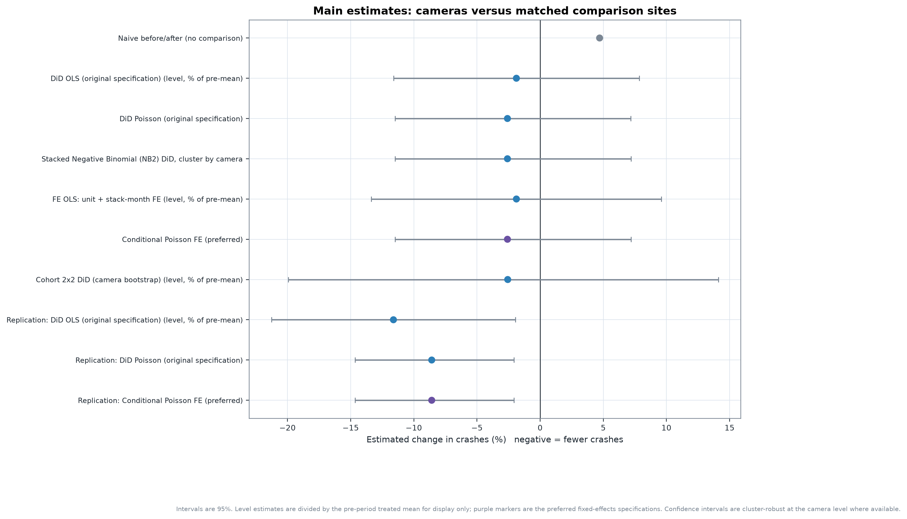
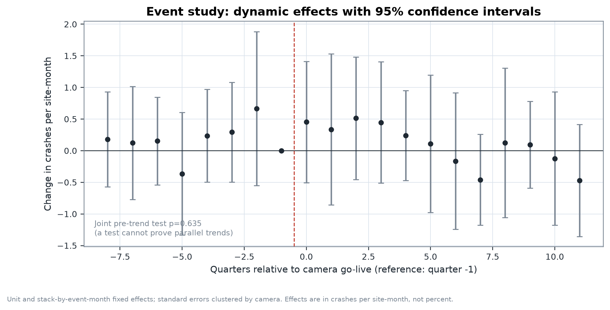

# Do Chicago speed cameras reduce crashes?

A reproducible causal-inference study of Chicago's speed-camera programme using public Chicago Data
Portal data. The design compares crash counts within **250 m** of each camera with **matched Chicago
locations that never had a camera**, before and after go-live.

> **Status:** research upgrade of an existing collaborative project. Not peer reviewed. The original
> notebook is preserved unchanged at the repository root; the upgraded analysis lives in
> `src/chicago_cameras/` and `notebooks/research_analysis.ipynb`.

---

## Research objective

Speed cameras are installed where crashes are already high, so a simple before/after comparison
conflates the camera's effect with mean reversion and with city-wide changes such as COVID-19. This
project estimates the **causal effect of a camera on reported crashes in its catchment**, using:

- a stacked, matched difference-in-differences design (each camera is its own experiment);
- local comparison sites with similar pre-period level and trend;
- fixed effects that absorb every shock shared by a camera and its comparison sites;
- a staggered-adoption-robust 2×2 estimator;
- an event study, a synthetic control and a full placebo/sensitivity programme.

**Estimand:** average effect on **reported crashes per catchment-month** for cameras going live in
2018–2024 with a complete 24-month pre-period and 36-month post-period. This is **not** crashes per
vehicle-mile; no exposure denominator is available.

---

## Findings

| Estimator | Effect | 95% interval | p | Cameras |
|---|---|---|---|---|
| **Primary — conditional Poisson FE** | **−2.6%** | **[−11.5%, +7.2%]** | 0.59 | 20 |
| Negative Binomial (NB2), same design | −2.6% | [−11.5%, +7.2%] | 0.59 | 20 |
| FE OLS (same design) | −0.07 crashes/site-month | [−0.49, +0.35] | 0.74 | 20 |
| Cohort 2×2, camera bootstrap | −0.09 crashes/site-month | [−0.74, +0.52] | 0.79 | 20 |
| Naive before/after (no controls) | +4.7% | — | — | 20 |
| **Original specification, original sample** | **−7.3%** | **[−13.6%, −0.6%]** | 0.034 | 33 |
| Original sample, corrected projection | −8.6% | [−14.7%, −2.1%] | 0.011 | 33 |
| Synthetic control (largest cohort) | +4.2% | pseudo-p ≈ 0.50 | — | 7 |

**How to read this.** The original study's statistically significant −7% is reproducible from the
saved notebook, but it is **not robust** to two defensible design changes: using local comparison
sites instead of citywide matching, and removing cameras whose 250 m catchment overlaps a camera that
is already live. With those changes the estimate is a wide, imprecise null: the data are consistent
with a meaningful reduction, no effect, or a modest increase. The synthetic control has only a
moderate pre-period fit and points in the opposite direction, so it does not corroborate a reduction.





---

## What the upgrade changes

The full audit is in [`docs/AUDIT.md`](docs/AUDIT.md). The main corrections:

| Issue | Original | Upgrade |
|---|---|---|
| Distance projection | Flat lon/lat approximation | UTM zone 16N metres (EPSG:26916) |
| Matching radius | README claims 1 km; code matched **citywide** | Explicit 2 km local matching; 1 km and citywide as sensitivity |
| Overlapping camera catchments | Kept; 36% of attributed crashes fall in ≥2 catchments | Cameras overlapping an already-live camera are dropped; `keep_all` sensitivity |
| Missing vs zero months | Sparse 2015 months treated as observed zeros | Coverage guard starts the window at 2015‑09 |
| Staggered adoption | Pooled OLS/Poisson only | Conditional Poisson FE + per-camera 2×2 with bootstrap |
| Inference | Cluster-robust SE with 33 clusters | Adds wild cluster bootstrap and placebo inference |
| Severity | Injury data downloaded but unused | Injury and severe/fatal outcomes |
| Mechanism | "Drivers adapted" from a descriptive curve | Within-camera slope with explicit non-causal caveats |
| Reproducibility | Colab/Drive, no pins, no tests | Package, config, provenance, checksums, 39 tests, CI |

---

## Data

All from the [Chicago Data Portal](https://data.cityofchicago.org):

| Dataset | ID | Used for |
|---|---|---|
| Speed Camera Locations | `4i42-qv3h` | 209 cameras, coordinates, go-live dates |
| Traffic Crashes – Crashes | `85ca-t3if` | 1,106,882 records; outcome |
| Speed Camera Violations | `hhkd-xvj4` | 502,120 daily records; mechanism check |

The raw download is preserved with query parameters, timestamps, row counts and SHA-256 checksums in
`data/raw/provenance.json`. Data are not committed. See
[`docs/DATA_DICTIONARY.md`](docs/DATA_DICTIONARY.md).

Observed crash window: **2015‑09 … 2026‑08**, 132 months. The portal table is effectively complete
from 2015‑09; earlier months are missing, not zero.

---

## Method (short)

1. **Unit**: site-month. Treated site = 250 m catchment around a camera. Comparison site = 500 m
   lattice point ≥600 m from every camera with ≥100 crashes and ≥40% active months.
2. **Matching**: five comparison sites per camera, closest on pre-period level and slope, evaluated
   in each camera's own pre-window.
3. **Preferred estimator**: conditional Poisson with site fixed effects and camera × event-month
   fixed effects. Coefficient = log rate ratio; `exp(β) − 1` = percent change.
4. **Staggered adoption**: per-camera 2×2 ATT relative to the month before go-live, averaged across
   cameras with a camera-level bootstrap.
5. **Event study**: quarterly effects, reference quarter −1, joint pre-trend test.
6. **Synthetic control**: de-meaned simplex fit, 200 placebo-in-space draws, in-time placebos,
   leave-one-out donors, and a pre-fit gate.
7. **Falsification**: placebo go-live dates, 200 random-location placebos, lattice-phase shifts,
   COVID exclusion, reporting-era split, severity outcomes.

Full details and identification assumptions: [`docs/METHODOLOGY.md`](docs/METHODOLOGY.md).

### Key assumptions

- Parallel trends conditional on the match (tested, not proven).
- No anticipation; warning periods are not observed.
- No interference beyond 250 m; the 600 m buffer removes catchment overlap, not spillover.
- Camera siting is not driven by unobserved, time-varying local trends. **This is the weakest
  assumption**: regression to the mean remains a threat.
- Overlapping-catchment cameras are excluded so treated units are independent.

---

## Reproduce

```bash
python3 -m venv .venv
source .venv/bin/activate
pip install -e ".[dev,dashboard]"

python scripts/download_data.py
python -m chicago_cameras.pipeline --config config/analysis.yaml

# verify the original study's published numbers
python scripts/verify_replication.py

# tests (no data download, no network)
python -m pytest -q
```

Or run everything:

```bash
bash scripts/run_all.sh
```

Runtime: download ≈ 5 min; analysis ≈ 15–20 min on an M1 laptop. A `--quick` flag reduces bootstrap
and placebo draws for development.

Expected replication output:

```
crashes kept          1,081,474
camera sample         33 of 209
panel rows            11,880
pre means             twins 4.298 | cameras 4.403
OLS      -0.3557 [-0.7110, -0.0005]  p=0.0497
Poisson  -7.3% [-13.6%, -0.6%]  p=0.0342
```

These match the notebook's saved outputs to four decimal places.

### Dashboard

```bash
streamlit run dashboard/app.py
```

The dashboard reads precomputed validated artefacts only. It never refits a model and shows an
explicit "results not generated" state when artefacts are missing.

---

## Repository structure

```text
.
├── README.md
├── pyproject.toml
├── config/analysis.yaml           # every design and inference parameter
├── data/                          # gitignored raw + processed data
│   ├── raw/                       # gzip CSV + provenance.json
│   └── processed/                 # parquet + quality_report.json
├── src/chicago_cameras/
│   ├── acquisition.py             # paginated, retryable Socrata download + provenance
│   ├── cleaning.py                # schema validation, coverage guard, severity flags
│   ├── geospatial.py              # UTM projection, counting, overlap diagnostics
│   ├── matching.py                # pre-trend matching with distance cap and caliper
│   ├── panel.py                   # stacked site-month panel + validation
│   ├── design.py                  # catchments, comparison sites, treatment timing
│   ├── did.py                     # OLS/Poisson, FE absorption, conditional Poisson, 2×2
│   ├── event_study.py             # dynamic effects and persistence
│   ├── synthetic_control.py       # simplex fit, placebos, leave-one-out
│   ├── robustness.py              # sensitivity and falsification
│   ├── visualization.py           # ten publication figures (PNG + SVG)
│   └── pipeline.py                # end-to-end orchestration
├── notebooks/research_analysis.ipynb   # upgraded notebook (reads validated artefacts)
├── dashboard/app.py               # Streamlit reader of precomputed results
├── scripts/
│   ├── download_data.py
│   ├── verify_replication.py
│   └── run_all.sh
├── tests/                         # 37 synthetic-fixture tests
├── results/
│   ├── estimates.json
│   ├── tables/*.csv
│   └── figures/*.png|svg
├── docs/
│   ├── README.md
│   ├── AUDIT.md
│   ├── METHODOLOGY.md
│   ├── DATA_DICTIONARY.md
│   ├── REPRODUCIBILITY.md
│   ├── REPORT.md
│   └── ORIGINAL_README.md
└── Do_Chicago_speed_cameras_reduce_crashes_.ipynb   # original notebook, untouched
```

---

## Limitations

- **Camera siting is non-random.** Matching on pre-period level and slope reduces but cannot remove
  regression to the mean.
- **Small treated sample.** 20 cameras in the primary design; confidence intervals are wide and
  cluster-robust inference is fragile with so few clusters.
- **Reporting changes.** 2016 crash volume is roughly one third of 2018; if reporting changed
  differentially across neighbourhoods, the DiD is biased.
- **COVID-19.** Traffic fell sharply in 2020; camera-by-month fixed effects absorb city-wide shocks
  but not uneven local impact.
- **No exposure denominator.** Crashes per catchment-month is not crashes per vehicle-mile.
- **Spillover and displacement.** The buffer prevents catchment overlap but cannot detect crashes
  moving beyond 250 m.
- **Treatment timing.** Go-live dates are monthly; warning periods and downtime are not observed.
- **External validity.** The 2013–14 rollout cannot be evaluated because crash data begin in 2015.
- **Synthetic control.** Pre-period fit is moderate (R² 0.74) and its sign disagrees with the DiD.

---

## References

- Abadie, A., Diamond, A., & Hainmueller, J. (2010). Synthetic control methods for comparative case
  studies. *Journal of the American Statistical Association*, 105(490), 493–505.
  [doi:10.1198/jasa.2009.ap08746](https://doi.org/10.1198/jasa.2009.ap08746)
- Bertrand, M., Duflo, E., & Mullainathan, S. (2004). How much should we trust
  differences-in-differences estimates? *Quarterly Journal of Economics*, 119(1), 249–275.
  [doi:10.1162/003355304772839588](https://doi.org/10.1162/003355304772839588)
- Callaway, B., & Sant'Anna, P. H. C. (2021). Difference-in-differences with multiple time periods.
  *Journal of Econometrics*, 225(2), 200–230.
  [doi:10.1016/j.jeconom.2020.12.001](https://doi.org/10.1016/j.jeconom.2020.12.001)
- Cameron, A. C., Gelbach, J. B., & Miller, D. L. (2008). Bootstrap-based improvements for inference
  with clustered errors. *Review of Economics and Statistics*, 90(3), 414–427.
  [doi:10.1162/rest.90.3.414](https://doi.org/10.1162/rest.90.3.414)
- de Chaisemartin, C., & D'Haultfœuille, X. (2020). Two-way fixed effects estimators with
  heterogeneous treatment effects. *American Economic Review*, 110(9), 2964–2996.
  [doi:10.1257/aer.20181169](https://doi.org/10.1257/aer.20181169)
- Goodman-Bacon, A. (2021). Difference-in-differences with variation in treatment timing.
  *Journal of Econometrics*, 225(2), 254–277.
  [doi:10.1016/j.jeconom.2021.03.014](https://doi.org/10.1016/j.jeconom.2021.03.014)
- Graham, D. J., Naik, C., McCoy, E. J., & Li, H. (2019). Do speed cameras reduce road traffic
  collisions? *PLoS ONE*, 14(9), e0221267.
  [doi:10.1371/journal.pone.0221267](https://doi.org/10.1371/journal.pone.0221267)
- Pilkington, P., & Kinra, S. (2005). Effectiveness of speed cameras in preventing road traffic
  collisions and related casualties: systematic review. *BMJ*, 330(7487), 331–334.
  [doi:10.1136/bmj.38324.646574.AE](https://doi.org/10.1136/bmj.38324.646574.AE)
- Retting, R. A., Ferguson, S. A., & McCartt, A. T. (2003). A review of evidence-based traffic
  engineering measures designed to reduce pedestrian–motor vehicle crashes. *American Journal of
  Public Health*, 93(9), 1456–1463.
  [doi:10.2105/AJPH.93.9.1456](https://doi.org/10.2105/AJPH.93.9.1456)
- Sun, L., & Abraham, S. (2021). Estimating dynamic treatment effects in event studies with
  heterogeneous treatment effects. *Journal of Econometrics*, 225(2), 175–199.
  [doi:10.1016/j.jeconom.2020.09.006](https://doi.org/10.1016/j.jeconom.2020.09.006)
- Wilson, C., Willis, C., Hendrikz, J. K., Le Brocque, R., & Bellamy, N. (2010). Speed cameras for
  the prevention of road traffic injuries and deaths. *Cochrane Database of Systematic Reviews*,
  2010(11), CD004607.
  [doi:10.1002/14651858.CD004607.pub3](https://doi.org/10.1002/14651858.CD004607.pub3)

Bibliographic details were checked against DOI records. Cited findings are the cited authors' work;
they are not findings of this project.

---

## Acknowledgments

The original study, notebook and README were created by the repository owner
([`amruthakakumani`](https://github.com/amruthakakumani)) and contributors; see the git history for
individual commits. The original notebook is preserved unchanged. The original README is preserved verbatim at
[`docs/ORIGINAL_README.md`](docs/ORIGINAL_README.md). This upgrade was built on that work and does
not claim authorship of it.

No affiliation, credential, publication or peer-review status is asserted for any contributor.

## License

The upstream repository does not declare a license. No license file is added here because
re-licensing requires the copyright holders' authorization. Add one only with the owners' consent.
