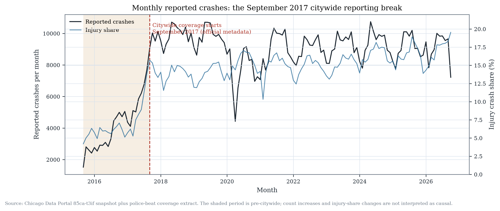
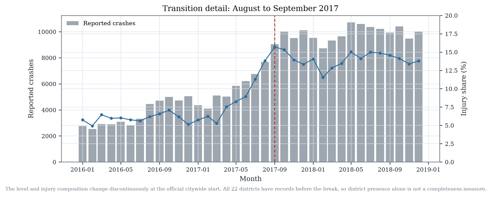
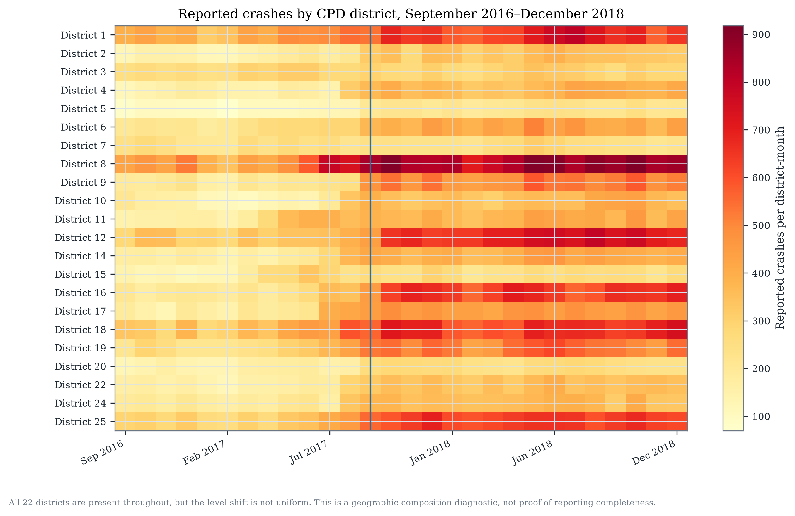
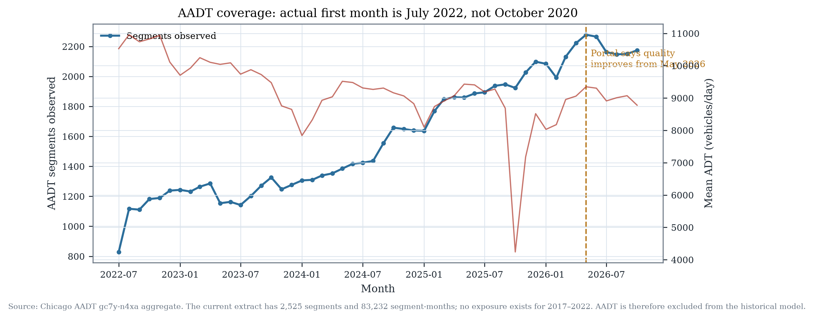
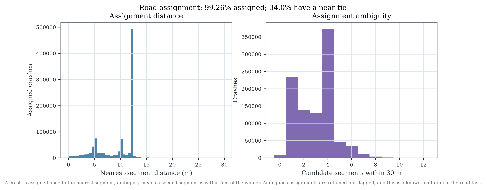

# Bottom-up scientific audit

**Date:** 2026-10-27
**Branch:** `research/bottom-up-forecasting`
**Status:** publication work preserved; new evidence is uncommitted.

This audit starts from the raw portal extract, not from the publication prose.
It asks whether the existing learning and causal problems were correctly
defined before any new model is attempted.

---

## 1. Inputs and snapshot

| Input | Value |
|---|---|
| Crash snapshot | `data/raw/crashes.csv.gz`; 1,106,882 rows |
| Snapshot acquisition | 2026-10-24 |
| Portal crash extract for coverage fields | 1,107,461 rows on 2026-10-26 |
| Camera table | 209 unique camera locations |
| AADT extract | 2,403,255 daily rows; 2,525 segments; 83,232 segment-months |
| TIGER geometry | 2024 EDGES, Cook and DuPage counties |
| Road sample | 73,088 city road segments; 15,126-segment modelling sample |

The official portal description is unambiguous:

> “Data from E-Crash are available for some police districts in 2015, but
> citywide data are not available until September 2017.”

That statement, not a crash-count threshold, is the primary evidence for the
reporting-regime boundary used below.

---

## 2. Issue register

| # | Issue | Evidence | Severity | Reproducible check |
|---|---|---|---|---|
| 1 | Citywide coverage starts in September 2017 | Official metadata; monthly count rises from 7,685 (2017-08) to 9,038 (2017-09); injury share rises from 13.8% to 15.7% | **High** | `python -m chicago_cameras.coverage`; `results/bottom_up/coverage/monthly_coverage.csv` |
| 2 | Existing V1/V2 target starts in January 2017 | `MLDatasetConfig.target_start = 2017-01-01`; the first eight target months are pre-citywide | **High** | `data/processed/ml_dataset.parquet`; `results/ml/metrics.json` |
| 3 | The original causal pre-period mixes partial and citywide reporting | Existing 2015-09 start includes 24 pre-months for 2019+ cameras, but not all months were citywide | **High** | `results/estimates.json`; `data/processed/quality_report.json` |
| 4 | Duplicate spatial attribution at overlapping cameras | 34,222 crashes (36.3%) fall inside two or more 250 m catchments; 107 camera pairs <500 m apart | **High** | `results/estimates.json → diagnostics.camera_attribution_all_cameras` |
| 5 | Missing and non-Chicago coordinates | 8,673 missing coordinates (0.78%); 75 zero coordinates; 8,748 raw points outside the analysis bbox | **Medium** | `python -m chicago_cameras.coverage`; `quality_report.json` |
| 6 | Crash-report amendments and post-snapshot additions | 240 `AMENDED` records in the snapshot; current portal has 581 new records and 2 records absent from the current extract; no per-record version history | **Medium** | `data/raw/crash_coverage_fields.parquet`; `results/bottom_up/coverage/summary.json` |
| 7 | Reporting/finalization lag is not directly observable | `date_police_notified` median 0.02 d, p95 2.53 d, p99 9.17 d; >30 d 0.17%; the portal exposes no report-finalization timestamp | **Medium** | `results/bottom_up/coverage/summary.json` |
| 8 | Injury composition changes with coverage | Injury share 7.7% in 2016-09…2017-08 vs 14.1% in 2017-09…2018-08 | **High** | `results/bottom_up/coverage/monthly_coverage.csv` |
| 9 | No historical traffic exposure | AADT current extract starts 2022-07, not the stated 2020-10; 2,525 segments cover 2,403,255 daily rows but only 1,454 distinct 2024 road segments; no 2017–2022 values | **High** | `python -m chicago_cameras.exposure`; `results/bottom_up/exposure/summary.json` |
| 10 | Camera-derived AADT is not an exogenous exposure measure | Portal says counts are by-products of traffic/speed cameras; counts may respond to enforcement and device conditions | **High** (for exposure-adjusted inference) | `docs/BOTTOM_UP_AUDIT.md`; portal metadata |
| 11 | Treatment timing is coarse and incomplete | Only go-live date; no warning-period end, uptime, enforcement hours or downtime; go-live month is partially treated | **Medium** | `data/processed/cameras.parquet`; sensitivity `treatment_month_offset` |
| 12 | Statistical dependence at camera and spatial levels | 15 primary coverage-consistent cameras; shared comparison controls; camera-clustered and block-bootstrap inference required | **High** | `results/bottom_up/coverage_causal/estimates.json`; `common_comparison.json` |
| 13 | Road assignment is ambiguous for one third of crashes | 99.26% assigned within 30 m; 331,234 (34.0%) have a second segment within 5 m; 2,214 are >20 m from the winner | **High** (for road task) | `python -m chicago_cameras.road_network`; `results/bottom_up/roads/assignment_summary.json` |
| 14 | Missing periods cannot be treated as zero | 2013–2015 is sparse; 2015-01…08 has 476 records; early 2017 is partial; the portal is a census only after citywide coverage | **High** | `quality_report.json`; `monthly_coverage.csv` |

---

## 3. What the coverage diagnostics show

The monthly table is a diagnostic, not a completeness estimator. All 22 CPD
districts have at least one record in every month from 2015-09 onward, including
the pre-citywide period; district presence therefore cannot prove citywide
coverage. The level and
injury composition still change sharply at the official boundary:

| Period | Mean monthly crashes | Mean injury share |
|---|---:|---:|
| 2016-09 … 2017-08 | 5,382 | 7.7% |
| 2017-09 … 2018-08 | 9,817 | 14.1% |

The August-to-September 2017 change is +17.6% in total crashes and +1.9
percentage points in injury share. The count increase is not interpreted as a
real safety deterioration; the official metadata says the reporting regime
changed.

The processed analysis used in the publication starts in 2015-09 after a
coverage guard. That guard removes the nearly empty early months, but it does
**not** make 2015-09…2017-08 citywide. The V1/V2 models start their target in
2017-01, so their first eight target months sit inside the partial regime.







---

## 4. Record-level audit

| Check | Result |
|---|---|
| Snapshot rows | 1,106,882 |
| Unique crash IDs | 1,106,882 |
| Duplicate IDs | 0 |
| Current portal rows | 1,107,461 |
| New after snapshot | 581 |
| Absent from current extract | 2 |
| Missing coordinates | 8,673 |
| Zero coordinates | 75 |
| Raw points outside bbox | 8,748 |
| AMENDED report type | 240 |

The portal says records are added when a report is finalized or amended, but it
does not expose a historical record version. We can detect that records were
added after the snapshot; we cannot reconstruct what an amended record looked
like before amendment. This is a real limit on amendment audit, not something a
new model can fix.

Notification delay is short for most records, but it measures police
notification, not portal publication. The two-month operating lag is retained as
a conservative rule. The last two source months (2026-09 and 2026-10) are marked
incomplete; the model window ends 2026-08.

---

## 5. Exposure audit

The AADT dataset does **not** support a 2017–2026 exposure-adjusted forecast:

- Official description: data from October 2020; quality improves from May 2026.
- Actual current extract: first month **2022-07**, last 2026-10.
- 2,525 segment IDs, 83,232 segment-months, 52 months.
- 14 segment-months above 100,000 ADT; no non-positive mean ADT.
- 1,454 distinct 2024 road segments matched within 50 m (2.0% of the 73,088
  city road segments).
- 199/209 camera locations have an AADT segment within 250 m, but segment
  identity and time coverage are insufficient for historical merging.
- Counts are camera-derived; using them as an exogenous exposure denominator for
  enforcement studies risks treatment-related measurement bias.

Decision: **retain count-based forecasting and document the missing exposure
denominator.** A normalized crash rate is not computed for 2017–2021 because no
valid historical denominator exists.



---

## 6. Geographic-unit audit

The original 250 m camera catchment is retained for historical comparability.
The prediction-oriented road design uses TIGER/Line 2024 EDGES clipped to the
City of Chicago community-area union:

- 73,088 road segments; 3,126 major (primary/secondary), 69,962 local.
- 6,659 km of road; median segment length 54.9 m.
- 98.9% of 2024 Cook segments existed as 2017 TIGER TLIDs; 6,633 older segments
  are absent and 795 are new. The 2024 geometry is therefore usable but not a
  perfect historical map.

Crash assignment:

| Check | Result |
|---|---|
| Crashes in city/window | 982,255 |
| Assigned within 30 m | 975,033 (99.26%) |
| Unassigned | 7,222 |
| Median assignment distance | 12.06 m |
| 95th percentile | 12.32 m |
| Ambiguous (second segment within 5 m) | 331,234 (34.0%) |
| Low-confidence (>20 m) | 2,214 (0.23%) |

Each crash is assigned once. The 34% ambiguity rate is high because Chicago has
dense intersections, divided roads and parallel TIGER edges. Ambiguity is
therefore a first-class limitation of the road task, not a detail to hide.

The modelling sample is all 3,126 major segments plus 12,000 seeded local
segments: 15,126 segments, 1,633,608 segment-months, 2,440 zero-crash segments,
and 23.6% of all assigned crashes. It is not a citywide road census, and its raw
MAE is not comparable to the camera-zone task.



---

## 7. Causal consequences

A coverage-consistent design was rebuilt from 2017-09 onward. Requiring 24
citywide pre-months and 36 post-months leaves **15 cameras** (go-live
2021-07…2023-07). The conditional Poisson estimate is **−8.6%**
[−16.9%, +0.4%], p = 0.061; the cohort 2×2 estimate is −0.075
[−0.773, +0.605] crashes/site-month; the joint pre-trend p-value is 0.855. The
geographic placebo one-sided p-value is 0.25.

This is not a direct replication of the publication's −2.6%: the sample,
citywide window and cohort composition all change. It shows that the reporting
regime can move the estimate materially. It does **not** establish a stronger
camera effect.

| Design | Cameras | Estimate | 95% CI | p | Pre-trend p |
|---|---:|---:|---|---:|---:|
| Original notebook (2015 start) | 33 | −7.3% | [−13.6, −0.6] | 0.034 | — |
| Revised local design (2015 start) | 20 | −2.6% | [−11.5, +7.2] | 0.591 | 0.635 |
| Coverage-consistent 24/36 | 15 | −8.6% | [−16.9, +0.4] | 0.061 | 0.855 |
| Coverage-consistent 12/36 | 16 | −6.9% | [−15.2, +2.2] | 0.131 | 0.507 |

---

## 8. What remains unverifiable

1. **Pre-September 2017 completeness by district/beat.** The portal exposes no
   reporting-rate denominator; all 22 districts have records, so presence is not
   completeness.
2. **Report version history.** Amendments are visible as a current record type,
   not as a diff.
3. **Camera uptime, warning periods and enforcement hours.** Not in the public
   camera table.
4. **Historical AADT before 2022-07.** The current extract has no such rows; a
   backfill would be fabrication.
5. **Historical road geometry for every year.** 2017 and 2024 TIGER can be
   compared, but not every year, and not at block-face level.
6. **A causal road-segment effect.** The road model is predictive only; road
   assignment ambiguity and nonrandom camera placement prevent a causal reading.

---

## 9. Reproduction

```bash
python -m chicago_cameras.coverage
python -m chicago_cameras.exposure
python -m chicago_cameras.road_network
python -m chicago_cameras.ml.coverage_dataset
python -m chicago_cameras.ml.reconstruction
python -m chicago_cameras.ml.tune_coverage
python -m chicago_cameras.ml.road_model
python scripts/make_bottom_up_figures.py
```

Artifacts are under `results/bottom_up/`. The final paper (`paper/Chicago_Speed_Cameras_Research.pdf`), deployed V1 artifacts and the reproducible V2 workflow are retained; promotional drafts were removed from the public release.
