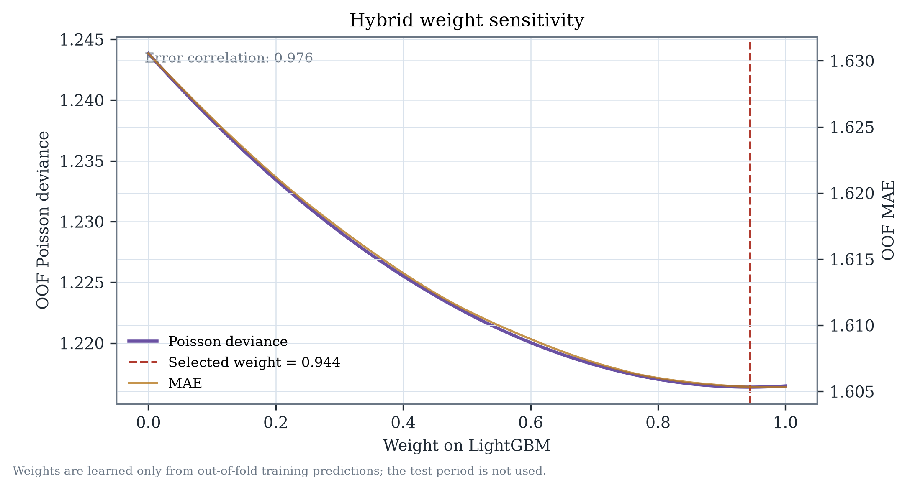

# Hybrid forecasting methods

## 1. Objective

The hybrid tests whether a transparent combination of the optimized LightGBM
forecast and a Negative Binomial count model improves month-ahead crash
predictions on the same coverage-consistent location-months.

This is a **forecasting ensemble**, not a causal model. No camera coefficient is
interpreted causally.

## 2. Components

### LightGBM component

The optimized LightGBM candidate is the preserved coverage-tuned model:

- Poisson objective.
- 78 leakage-safe features: history, calendar, weather, static geography,
  TIGER road network, neighbourhood history, citywide regime and long history.
- 8 Optuna trials; final batch size/rounds recorded in
  `results/bottom_up/coverage_model/coverage_tuned_metrics.json`.
- OOF predictions from three expanding temporal folds.
- Test predictions from a refit on all pre-test rows.

### Negative Binomial component

NB2 generalized linear model with log link:

\[
y_{it} \sim \mathrm{NB2}(\mu_{it}, \alpha), \qquad
\log(\mu_{it}) = \log(\overline{y}_{i,<t}+0.5) + X_{it}\beta
\]

The offset uses only the location's prior expanding mean. The 26 numeric
features plus cluster indicators are listed in
`src/chicago_cameras/ml/statistical_experiment.py` and
`docs/MODEL_EXPERIMENT_BASELINE.md`. Dispersion is estimated from training
Pearson residuals; final temporal alpha is **0.1038** (NB2).

The NB is deliberately compact, not an enormous fixed-effects regression. It is
used for prediction only; correlated coefficients are not interpreted causally.

## 3. Convex combination

\[
\widehat{y}_{it}^{hybrid} = w\,\widehat{y}_{it}^{LGBM} + (1-w)\,\widehat{y}_{it}^{NB},
\qquad 0 \le w \le 1.
\]

The weight is learned on **out-of-fold training predictions only** by minimizing
Poisson deviance with a bounded scalar search (`scipy.optimize.minimize_scalar`).
No test-period prediction enters the weight. The selected weight is **0.943952**
on LightGBM and **0.056048** on NB.

All component and hybrid predictions are clipped at zero.

## 4. Why the hybrid is nearly LightGBM

The OOF residuals of LightGBM and NB are highly correlated:

\[
\mathrm{corr}(y-\widehat{y}^{LGBM}, y-\widehat{y}^{NB}) = 0.976.
\]

The NB is materially weaker (OOF deviance 1.24384 versus 1.21647 for LightGBM).
A convex combination therefore puts almost all weight on LightGBM. Hybrid OOF
deviance is 1.21637, only 0.008% better than LightGBM. Test deviance is 1.21575
versus 1.21625, and test MAE 1.5768 versus 1.5775; these differences are far below
the 1% selection threshold.

## 5. Why no stacking model

A second-stage stacking model was **not** built. The simple convex hybrid did not
show a convincing improvement, and the component errors are highly correlated.
Adding a meta-learner would increase complexity without a defensible reason.

## 6. Validation discipline

- Weight learned on 23,868 OOF rows from three pre-test temporal folds.
- Test period 2025-09…2026-08 not used for weight or tuning.
- Geographic holdout uses 34 blocks and a 1 km buffer; the hybrid weight is fixed
  from temporal OOF and is not refit on the geographic holdout.
- Combined geographic + later-period results are retrospective and labelled so.
- Intervals are calibrated on OOF residuals; they are approximate, not exact
  finite-sample guarantees.

## 7. Limitations

1. NB linearity and compact feature set leave substantial location heterogeneity.
2. Component errors are correlated, so the hybrid has little diversity to exploit.
3. All candidates underpredict high-crash months.
4. The test period was previously inspected in V1; all test results are
   retrospective.
5. The hybrid requires two models and a stored weight; its operational complexity
   is not justified by the observed gain.
