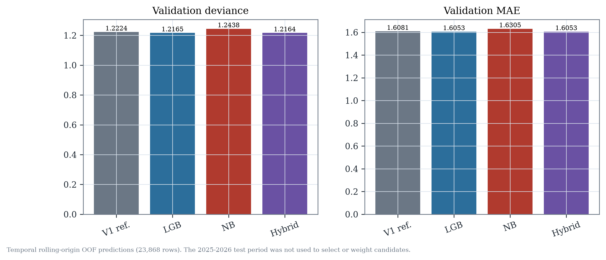
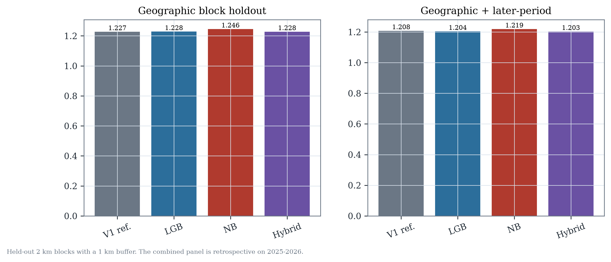

# Model experiment results

**Experiment:** LightGBM vs Negative Binomial vs convex hybrid
**Data:** coverage-consistent camera-zone dataset, 2018-01…2026-08
**Test:** 2025-09…2026-08, 15,912 rows; previously inspected in V1, so retrospective

---

## 1. Candidate definitions

| Candidate | Definition |
|---|---|
| Coverage V1 reference | 44-feature LightGBM trained on the same coverage-consistent rows |
| Optimized LightGBM | Existing coverage-tuned LightGBM, 78 features, 8 Optuna trials, rounds 1,207 |
| Negative Binomial | NB2 GLM, 26 historically available features + 9 cluster indicators + intercept; log link with historical-scale offset; alpha 0.1038 in final temporal fit |
| Hybrid | Convex combination, `w × LightGBM + (1−w) × NB`; `w = 0.943952` learned on OOF rows |

The optimized LightGBM is the strongest LightGBM candidate from the preserved
reconstruction experiment; no test-period information was used to tune it.

## 2. LightGBM feature ablation

The existing coverage-consistent ablation used fixed V1 hyperparameters so that
feature-group changes were not confounded by tuning noise.

| Feature set | Features | Validation deviance | Validation MAE |
|---|---:|---:|---:|
| Minimal history/calendar/geography | 34 | 1.2249 | 1.6104 |
| + camera operation | 37 | 1.2253 | 1.6103 |
| + weather | 43 | 1.2211 | 1.6068 |
| + road network | 56 | 1.2198 | 1.6054 |
| + neighbourhood | 62 | 1.2189 | 1.6045 |
| + citywide | 69 | 1.2187 | 1.6081 |
| + long history (full) | 78 | 1.2167 | 1.6059 |
| Coverage-consistent V1 reference | 44 | 1.2224 | 1.6081 |

The full set improves validation deviance by 0.67% versus the minimal set. The
optimized model used 78 features, 8 Optuna trials, best validation deviance
1.21647, and 1,207 final boosting rounds. No test row entered feature selection or
tuning.

## 3. Temporal validation

Three expanding six-month folds, 23,868 OOF rows, identical across candidates.

| Candidate | OOF MAE | OOF Poisson deviance |
|---|---:|---:|
| Coverage V1 reference | 1.6081 | 1.22238 |
| Optimized LightGBM | **1.6053** | **1.21647** |
| Negative Binomial | 1.6305 | 1.24384 |
| Hybrid | **1.6053** | **1.21637** |

The hybrid's OOF deviance is 0.008% better than optimized LightGBM and 0.49%
better than coverage V1. It does not reach the pre-declared 1% threshold.

## 4. Retrospective test metrics

| Candidate | MAE | RMSE | Poisson deviance | R² | Bias |
|---|---:|---:|---:|---:|---:|
| Coverage V1 | 1.5799 | 2.1069 | 1.22010 | 0.6586 | +0.119 |
| Optimized LightGBM | 1.5775 | 2.1025 | 1.21625 | 0.6600 | +0.127 |
| Negative Binomial | 1.5913 | 2.1267 | 1.23321 | 0.6522 | +0.110 |
| Hybrid | **1.5768** | **2.1013** | **1.21575** | **0.6604** | +0.126 |

The hybrid is the best point/deviance candidate on the retrospective test rows,
but the differences from optimized LightGBM are very small. It is not a
statistically compelling improvement (see bootstrap).

## 5. Geographic and combined validation

Geographic block holdout: 34 blocks, 290 locations, 3,480 rows, 1 km buffer.

| Candidate | Geographic MAE | Geographic deviance | Combined MAE | Combined deviance |
|---|---:|---:|---:|---:|
| Coverage V1 | 1.6197 | 1.22739 | 1.58386 | 1.20800 |
| Optimized LightGBM | 1.6160 | 1.22834 | 1.58434 | 1.20384 |
| Negative Binomial | 1.6266 | 1.24555 | 1.59163 | 1.21921 |
| Hybrid | **1.6154** | **1.22776** | **1.58344** | **1.20320** |

The combined panel is retrospective on 2025-09…2026-08 and is not a new
untouched confirmation. The hybrid improves geographic deviance slightly over
optimized LightGBM but not over coverage V1.

## 6. High-crash, zero-crash and hotspot performance

| Candidate | Zero MAE | High-decile MAE | High-decile actual | High-decile predicted | Precision@10% | Recall@10% |
|---|---:|---:|---:|---:|---:|---:|
| Coverage V1 | 1.747 | 2.939 | 10.99 | 9.02 | 0.722 | 0.554 |
| Optimized LightGBM | 1.745 | **2.922** | 10.99 | 9.02 | 0.718 | 0.551 |
| Negative Binomial | 1.773 | 3.051 | 10.99 | 9.03 | 0.710 | 0.545 |
| Hybrid | 1.747 | 2.924 | 10.99 | 9.02 | 0.719 | 0.552 |

The high-crash under-prediction persists in every candidate. The NB worsens the
high-count tail; the hybrid essentially inherits LightGBM's behavior.

## 7. Prediction intervals

Approximate 90% split-conformal intervals, calibrated on OOF predictions.

| Candidate | Overall coverage | Low-risk decile | High-risk decile | Mean width |
|---|---:|---:|---:|---:|
| Coverage V1 | 90.6% | 96.7% | 85.6% | 5.93 |
| Optimized LightGBM | 90.4% | 96.9% | 84.9% | 5.90 |
| Negative Binomial | 90.6% | 95.8% | 84.4% | 5.98 |
| Hybrid | 90.4% | 96.8% | 85.1% | 5.90 |

Conditional coverage remains below nominal in the highest-risk decile. These are
approximate intervals, not causal confidence intervals.

## 8. Statistical uncertainty and error correlation

Paired spatial-block bootstrap, 1,000 draws over 2 km blocks, versus coverage V1:

| Contrast | Deviance difference | 95% CI | MAE difference | 95% CI |
|---|---:|---|---:|---|
| Optimized LightGBM − V1 | −0.00389 | [−0.00661, −0.00104] | −0.00254 | [−0.00551, +0.00053] |
| Hybrid − V1 | −0.00437 | [−0.00724, −0.00163] | −0.00316 | [−0.00591, −0.00019] |
| NB − V1 | +0.01317 | [+0.00776, +0.01915] | +0.01129 | [+0.00396, +0.01908] |

The LightGBM/hybrid gains are measurable but small; NB is clearly worse. The
hybrid's OOF error correlation with LightGBM is **0.976**, which explains why its
weight is 94.4% LightGBM and why it offers little benefit.

## 9. Runtime and memory

| Measure | Value |
|---|---:|
| Optimized LightGBM training | 91.85 s |
| NB temporal fit and prediction | 38.58 s |
| NB final training | 21.60 s |
| NB inference, 15,912 rows | 0.051 s |
| LightGBM inference, 15,912 rows | 1.727 s |
| Peak process RSS | 986 MB |

The NB is much faster at inference but weaker. The hybrid requires two models and
an ensemble weight, increasing operational complexity for a negligible gain.

## 10. Figures

- `results/statistical_hybrid/figures/feature_correlation.png`
- `results/statistical_hybrid/figures/target_distribution.png`
- `results/statistical_hybrid/figures/monthly_seasonal.png`
- `results/statistical_hybrid/figures/mean_variance.png`
- `results/statistical_hybrid/figures/geographic_risk.png`
- `results/statistical_hybrid/figures/residual_diagnostics.png`
- `results/statistical_hybrid/figures/candidate_comparison.png`
- `results/statistical_hybrid/figures/geographic_performance.png`
- `results/statistical_hybrid/figures/high_risk_calibration.png`
- `results/statistical_hybrid/figures/hybrid_weight.png`

Full machine-readable summary: `results/statistical_hybrid/summary.json`.
