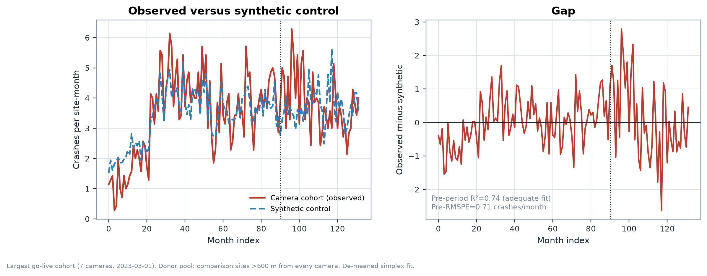
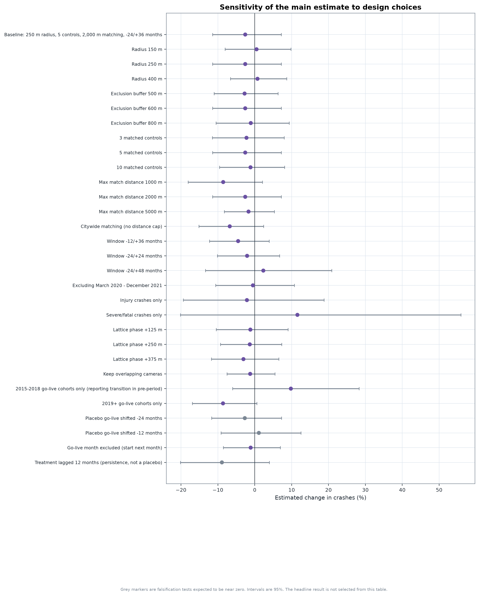
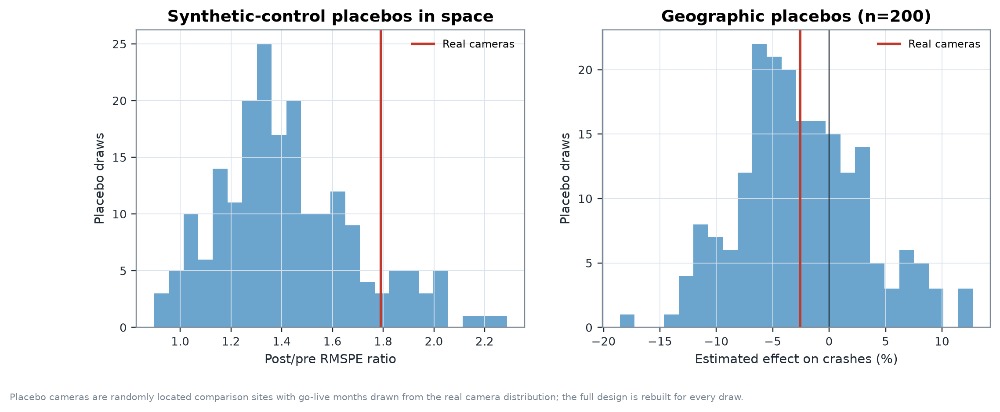

# Do Chicago speed cameras reduce crashes?

### A matched difference-in-differences study with a staggered-adoption audit

**Status:** research upgrade, not peer reviewed.
**Data:** Chicago Data Portal (public), snapshot 2026-10-24.
**Original study:** preserved unchanged at `Do_Chicago_speed_cameras_reduce_crashes_.ipynb`.
**Code:** `src/chicago_cameras/` · **Results:** `results/` · **Audit:** `docs/AUDIT.md`.

---

## Abstract

Speed cameras are placed where crashes are already high, so naive before/after comparisons confound
enforcement with mean reversion and with city-wide changes in traffic. This study estimates the
effect of Chicago's camera programme on reported crashes within 250 m of each camera, using a stacked
difference-in-differences design with local comparison sites matched on pre-period level and trend.
The primary estimator is a conditional Poisson model with site fixed effects and camera-by-month fixed
effects, which absorbs every shock shared by a camera and its comparison sites. It is complemented by
a per-camera 2×2 estimator that is robust to staggered adoption, an event study, a synthetic control,
and a large placebo and sensitivity programme.

The estimation sample contains 20 cameras with complete 24-month pre- and 36-month post-periods whose
catchments do not overlap an already-live camera. The preferred estimate is **−2.6% (95% CI −11.5% to
+7.2%; p = 0.59)**; the cohort 2×2 estimate is **−0.09 crashes per site-month (95% CI −0.74 to
+0.52)**. The data are therefore consistent with a meaningful reduction, no effect, or a modest
increase. The original study's published **−7.3%** is exactly reproducible from its notebook, but it
depends on citywide comparison sites that the README does not describe, retains overlapping camera
catchments, and is sensitive to arbitrary comparison-lattice placement. The synthetic control has a
moderate pre-period fit and points in the opposite direction, so it does not corroborate a reduction.
The main contribution of this upgrade is a corrected and fully reproducible design plus an explicit
demonstration that the earlier headline is not robust.

---

## 1. Research question

What is the causal effect of a Chicago speed camera on the number of reported crashes in the 250 m
around it, relative to what would have happened at a comparable Chicago location without a camera?

The policy question is not whether crash counts fall after a camera is installed — they usually do,
partly because cameras are sited at high-crash locations. The question is whether they fall **more
than they would have fallen anyway**.

## 2. Policy background

Chicago operates automated speed enforcement in school and park safety zones. The programme began in
2013 and expanded substantially in later years; the portal records a go-live date for each device.
Enforcement is typically preceded by a warning period, and the portal does not record camera downtime,
enforcement hours, or the end of the warning period. Those omissions matter for timing and are treated
as limitations rather than imputed.

Cameras are not randomly assigned. They are sited at locations selected for crash history, school
proximity and political geography. Any credible design must therefore compare camera catchments with
locations that were plausible candidates but did not receive a camera, and must address regression to
the mean directly.

## 3. Literature review

**Do speed cameras reduce crashes?** Systematic reviews generally find reductions in collisions and
casualties near cameras, with weaker evidence on wider-area effects and on severity. Pilkington and
Kinra (2005) review 14 observational studies and report reductions in collisions, while cautioning
about study quality and regression to the mean. The Cochrane review by Wilson et al. (2010) reaches a
similar conclusion, with the strongest evidence for fatal and serious injury outcomes. Graham et al.
(2019) study London's programme with a causal design and find reductions in collisions and casualties
near cameras, while noting displacement and heterogeneous effects. These are the cited authors'
findings, not findings of this project.

**Why design matters.** Bertrand, Duflo and Mullainathan (2004) show that naive DiD standard errors
are badly understated in the presence of serial correlation. Goodman-Bacon (2021) and de Chaisemartin
and D'Haultfœuille (2020) show that two-way fixed-effects estimands are weighted averages of 2×2
comparisons that can receive negative weights under staggered adoption and heterogeneous effects.
Callaway and Sant'Anna (2021) and Sun and Abraham (2021) provide group-time and event-study
alternatives. Abadie, Diamond and Hainmueller (2010) develop synthetic control, and Cameron, Gelbach
and Miller (2008) provide cluster-bootstrap inference for the small-cluster case. This study adopts
those lessons where the data support them.

**What this study adds.** A reproducible audit of an existing Chicago study: exact replication of the
published numbers, an explicit comparison of citywide and local matching, overlap diagnostics for
camera catchments, a coverage guard for missing early months, and a placebo/sensitivity programme. It
does **not** claim to resolve the causal question for Chicago; it shows how fragile the available
answer is.

## 4. Data sources

| Dataset | Portal ID | Rows in snapshot | Use |
|---|---|---|---|
| Speed Camera Locations | `4i42-qv3h` | 209 | Coordinates, go-live dates |
| Traffic Crashes – Crashes | `85ca-t3if` | 1,106,882 | Outcome |
| Speed Camera Violations | `hhkd-xvj4` | 502,120 daily tickets | Mechanism check |

The raw download is preserved as gzip CSV with the exact query, timestamps, row counts and SHA-256
checksums in `data/raw/provenance.json`. No private data, credentials or imputed observations are
used. Data are not committed to git.

**Coverage.** The crash table is complete enough for a coverage guard from 2015-09, but it is **not
citywide** until September 2017. 2015-01…08 contains 476 records and 2013–14 contains 8; those months
are treated as missing, not observed zeros. The last two calendar months are excluded because reports
are still being entered. The publication analysis window is **2015-09 … 2026-08 (132 months)**; the
coverage-consistent sensitivity begins in 2017-09 and has 15 cameras.

## 5. Data preprocessing

1. **Cameras.** Parse go-live dates and coordinates; drop rows missing either (none); collapse exact
   duplicate coordinates keeping the earliest date (none); require coordinates inside the Chicago
   bounding box (all 209 qualify). `go_live` is treated as the first month of enforcement.
2. **Crashes.** Parse timestamps and coordinates; drop missing coordinates (8,673, 0.8%); drop points
   outside Chicago (75); deduplicate crash ids (none); restrict to the analysis window (16,660 rows
   outside, including the reporting lag); drop leading months before reliable coverage (476 rows).
   Flag injury (`injuries_total > 0`) and severe (`fatal > 0` or `incapacitating > 0`) crashes.
   Convert `posted_speed_limit = 0` to missing.
3. **Projection.** Project WGS84 coordinates to **NAD83 / UTM zone 16N (EPSG:26916)**. Planar
   distances are accurate to a few parts per million and validated against great-circle distances.
4. **Counts.** For each site, count distinct crashes within 250 m per calendar month. A crash is
   counted at most once per site. Site-months with no crash inside the observed window are genuine
   zeros.
5. **Panel.** Stack each camera with its five matched comparison sites over event months −24…+35.
   Validate that every stack has one treated unit per month, no duplicate unit-month rows, no missing
   outcomes and the full event-time grid. Validation passes with zero problems.

## 6. Identification strategy

**Estimand.** The average effect of camera enforcement on reported crashes per catchment-month
(250 m) for cameras with complete windows. This is not crashes per vehicle-mile and not crashes per
road segment; no exposure denominator is available.

**Design.** Each camera is a mini-experiment. Comparison sites are 500 m lattice points at least
600 m from every camera, with at least 100 crashes and at least 40% active months. Five are chosen per
camera by a score combining the absolute difference in pre-period mean and pre-period slope, each
standardised in that camera's own pre-window. The primary maximum matching distance is 2,000 m
(1,000 m leaves only 11 of 33 eligible cameras with five comparison sites; citywide matching is the
original behaviour and is reported as a sensitivity).

**Assumptions.**

1. *Parallel trends* conditional on pre-period level and slope. Tested but not proven; the event
   study reports a joint pre-trend test with an explicit power caveat.
2. *No anticipation* beyond the recorded go-live month. Warning periods are unobserved; starting
   treatment one month later is a sensitivity.
3. *No interference.* The 600 m buffer rules out catchment overlap (600 > 2 × 250) but not behavioural
   spillover or crash displacement beyond 250 m.
4. *No differential shocks.* Camera-by-month fixed effects absorb anything common to a camera and its
   comparison sites, including citywide traffic, seasonality and COVID-19.
5. *No contamination from earlier cameras.* A camera whose catchment overlaps a camera that is
   already live is excluded. Among all 209 cameras, 34,222 crashes (36.3% of attributed crashes) fall
   inside two or more 250 m catchments, so this is not a cosmetic correction.
6. *Camera siting is not driven by unobserved, time-varying local trends.* This is the weakest
   assumption. Regression to the mean remains a threat even after matching on pre-trends.

## 7. Statistical methodology

- **Baseline (replication).** `y ~ treated + post + treated×post`, OLS and Poisson, clustered by
  camera stack — the original specification.
- **FE OLS.** Unit fixed effects and stack-by-event-month fixed effects, absorbed by alternating
  projections; cluster-robust standard errors by camera.
- **Negative Binomial (NB2).** The same regressors as the Poisson baseline, with a dispersion
  parameter estimated by maximum likelihood; reported because the Pearson dispersion is 2.53.
- **Conditional Poisson FE.** Conditioning on each stack-month total yields a binomial model for the
  treated count with the number of controls as exposure. This is numerically equivalent to Poisson
  with a full set of stack-month intercepts and avoids estimating thousands of dummies. The
  coefficient is a log rate ratio.
- **Cohort 2×2.** For each camera and event month, the DiD relative to the month before go-live
  against its own matched controls; average across cameras; percentile bootstrap over cameras. This
  avoids TWFE weighting under staggered adoption.
- **Event study.** Quarterly treated × event-time indicators with unit and stack-by-event-month fixed
  effects, reference quarter −1; joint Wald test on pre-period coefficients.
- **Synthetic control.** De-meaned simplex fit to the largest go-live cohort, 100 donors chosen on
  pre-period fit, 200 placebo-in-space draws, in-time placebos at −24 and −12 months, leave-one-out on
  the five most influential donors, and a pre-fit gate (R² < 0.50 ⇒ not informative).
- **Inference.** Cluster-robust SEs, wild cluster bootstrap-t (999 Rademacher replications,
  restricted null), camera-level bootstrap, placebo-in-space and placebo-in-time p-values.
- **Multiple comparisons.** Exploratory subgroups are Benjamini–Hochberg adjusted.
- **Software.** Python 3.11; pandas, numpy, scipy, statsmodels, scikit-learn, pyproj, shapely,
  matplotlib. All stochastic steps are seeded from `config/analysis.yaml` (`seed = 20261024`).

## 8. Main results

### 8.1 Sample

| Quantity | Value |
|---|---|
| Camera locations in source | 209 |
| Cameras inside the 24/36-month window | 33 |
| Dropped because catchment overlaps an already-live camera | 13 |
| Cameras with a matched comparison group | **20** |
| Candidate comparison sites | 1,226 |
| Crashes analysed | 1,080,998 |
| Months | 132 (2015-09 … 2026-08) |
| Site-month panel rows | 7,200 |

Pre-period balance: standardised mean difference in crash level **0.14**; differential pre-trend
**+0.007 crashes/site-month per month (95% CI −0.022 to +0.036; p = 0.62)**. There is no detectable
pre-trend difference.

### 8.2 Estimates

| Estimator | Effect | 95% interval | p |
|---|---|---|---|
| Naive before/after (no comparison) | +4.7% | — | — |
| Original OLS specification | −0.069 crashes/site-month | [−0.428, +0.289] | 0.71 |
| Original Poisson specification | −2.6% | [−11.5%, +7.2%] | 0.59 |
| Negative Binomial (NB2), same regressors | −2.6% | [−11.5%, +7.2%] | 0.59 |
| FE OLS (unit + camera×month FE) | −0.069 crashes/site-month | [−0.493, +0.354] | 0.74 |
| **Conditional Poisson FE (primary)** | **−2.6%** | **[−11.5%, +7.2%]** | **0.59** |
| Cohort 2×2 (camera bootstrap) | −0.095 crashes/site-month | [−0.735, +0.520] | 0.79 |
| Wild cluster bootstrap p (FE OLS) | — | — | 0.72 |

The Pearson dispersion statistic is **2.53**, so the Poisson model is overdispersed. The NB2 model
estimates α = 0.41 and produces the same coefficient (−2.6%) with cluster-robust standard errors, so
the Poisson and NB2 conclusions coincide; the conditional Poisson FE remains preferred because it
absorbs stack-by-month shocks.

The naive comparison *increases* crashes by 4.7%, a reminder that selection dominates a simple
before/after. The controlled estimates are negative but imprecise. The 95% interval is compatible
with a reduction of about one in nine crashes and with an increase of about one in fourteen.

**Interpretation.** This is an imprecise null, not evidence that cameras do nothing. With 20 treated
units and shared comparison sites, the design cannot resolve modest effects.

### 8.3 Event study

Quarterly effects fluctuate around zero with wide confidence intervals. The joint pre-trend test does
not reject (Wald χ² = 5.20 on 7 df, p = 0.64), but with 20 cameras the test has low power. Post-period
coefficients are mostly negative in later quarters but never individually distinguishable from zero.
The pattern is consistent with a delayed, modest effect at best.


### 8.4 Synthetic control

The largest go-live cohort is **2023-03 with 7 cameras**. The synthetic control's pre-period fit is
moderate: **R² = 0.74**, pre-RMSPE = 0.71 crashes/month against a pre-mean of 3.41 (21%). The
post-period gap is **+4.2%** — *more* crashes than the synthetic counterfactual — with a placebo-in-
space pseudo-p of ≈ 0.50 for a negative gap. In-time placebos and leave-one-out donor checks are in
`results/tables/sc_*.csv`.

**This is a disagreement, not corroboration.** The synthetic control does not support a reduction,
and its pre-fit is not strong enough to overturn the DiD. It is reported as an unresolved inconsistency
and a limit on what can be claimed.



## 9. Sensitivity analysis

The full table is `results/tables/sensitivity.csv`; the figure below shows every row.

| Specification | Cameras | Effect (%) | 95% CI | p |
|---|---|---|---|---|
| Baseline (250 m, 5 controls, 2 km matching) | 20 | −2.6 | [−11.5, 7.2] | 0.59 |
| Radius 150 m | 21 | +0.5 | [−8.0, 9.8] | 0.91 |
| Radius 400 m | 19 | +0.7 | [−6.6, 8.7] | 0.85 |
| Buffer 500 m | 20 | −2.8 | [−11.0, 6.3] | 0.54 |
| Buffer 800 m | 20 | −1.1 | [−10.5, 9.4] | 0.83 |
| 3 matched controls | 20 | −2.2 | [−11.5, 8.0] | 0.65 |
| 10 matched controls | 19 | −1.2 | [−9.6, 8.1] | 0.80 |
| Max match distance 1,000 m | 11 | −8.6 | [−18.1, 2.1] | 0.11 |
| Max match distance 5,000 m | 20 | −1.7 | [−8.2, 5.3] | 0.63 |
| **Citywide matching (original behaviour)** | 20 | **−6.8** | [−15.2, 2.4] | 0.14 |
| Window −12/+36 | 20 | −4.5 | [−12.3, 3.9] | 0.28 |
| Window −24/+24 | 23 | −2.1 | [−10.1, 6.7] | 0.63 |
| Window −24/+48 | 6 | +2.3 | [−13.4, 20.9] | 0.79 |
| Excluding 2020-03 … 2021-12 (COVID) | 20 | −0.5 | [−10.6, 10.7] | 0.93 |
| Injury crashes only | 20 | −2.1 | [−19.4, 18.8] | 0.83 |
| Severe/fatal crashes only | 20 | +11.6 | [−20.2, 55.9] | 0.52 |
| Lattice phase +125 m | 20 | −1.2 | [−10.5, 9.0] | 0.81 |
| Lattice phase +250 m | 20 | −1.4 | [−9.3, 7.3] | 0.75 |
| Lattice phase +375 m | 20 | −3.1 | [−11.8, 6.5] | 0.52 |
| Keep overlapping cameras | 33 | −1.3 | [−7.5, 5.4] | 0.71 |
| 2015–2018 go-live cohorts only | 5 | +9.8 | [−6.0, 28.3] | 0.24 |
| 2019+ go-live cohorts only | 15 | −8.6 | [−16.9, +0.5] | 0.06 |
| Original 2015+ sample, citywide, overlapping kept (replication) | 33 | −8.6 | [−14.7, −2.1] | 0.011 |

**What moves the estimate.** Local versus citywide matching is the single largest design lever:
citywide matching gives about −7%, local matching about −3%. The 1,000 m distance cap gives −8.6% but
retains only 11 cameras. Lattice phase and radius/buffer changes move the estimate by only about
2 percentage points under local matching. The era split is the most suggestive heterogeneity: the
2019+ cohorts give −8.6% (95% CI −16.9% to +0.5%) while the 2015–2018 cohorts give +9.8%
(95% CI −6.0% to +28.3%). That split is consistent with either a genuinely stronger effect for later
installations or the 2017 crash-reporting transition contaminating the earlier cohort's pre-period;
the public data cannot separate them. The original sample plus original design is the only
specification that is clearly statistically significant, and it is the least defensible one.

**Placebo tests.** Geographic placebos rebuild the design at random comparison-site locations with
go-live months drawn from the real distribution; the real estimate sits near the middle of the placebo
distribution (one-sided p = 0.53 for the DiD, 0.38 for the cohort estimator). Placebo go-live dates
(−24, −12 months) produce estimates close to zero. A +12-month lag is reported separately as a
persistence check, not a placebo.





### Falsification summary

- Pre-trend test: no rejection, low power.
- Placebo geography: real estimate in the middle of the distribution.
- Placebo dates: near zero.
- Lattice phase: small spread under local matching.
- COVID exclusion: estimate moves toward zero (as expected if cameras were more effective in the
  pandemic traffic regime, or if the sample is too small to tell).

## 10. Mechanism analysis

Violations per camera-month decline by about **−12.8% per year** within a camera's first 48 months
(SE 0.016 log points; 235 cameras, 8,731 camera-months). This is **not** evidence that drivers became
safer. Violations measure enforcement output: warning periods end, ticketing policy changes, camera
uptime changes, and the composition of the camera fleet changes. The decline is consistent with
adaptation, saturation, or operational changes, and cannot separate them.

The published claim that "drivers adapted" is therefore downgraded to a descriptive observation with
an explicit non-causal caveat.

## 11. Limitations

1. **Non-random siting.** Cameras are placed at high-crash sites; regression to the mean remains a
   threat despite matching on pre-period level and slope.
2. **Small treated sample.** 20 cameras and shared comparison sites; cluster-robust inference is
   fragile and the wild bootstrap p-values are the honest ones.
3. **Reporting changes.** 2016 crash volume is roughly one third of 2018. If reporting changed
   differentially across neighbourhoods, the DiD is biased. The era split shows the 2018 cohort
   behaving differently from later cohorts, which is a warning sign.
4. **COVID-19.** Camera-by-month fixed effects absorb common shocks, but not uneven local impact.
5. **No exposure denominator.** Crashes per catchment-month cannot be translated into risk per mile.
6. **Spillover and displacement.** The buffer prevents catchment overlap, not crash migration.
7. **Timing.** Go-live dates are monthly; warning periods and downtime are unobserved.
8. **External validity.** The 2013–14 rollout cannot be evaluated because crash data begin in 2015.
   The estimates apply to 2018–2024 installations with complete windows.
9. **Synthetic control.** Moderate fit and opposite sign; it neither confirms nor overturns the DiD.
10. **Geocoding.** Block-level coordinates; a 250 m circle may include adjacent streets.

## 12. Policy implications

The evidence in this sample does **not** support a precise claim that cameras reduced crashes, and it
does not support a claim that they failed. The confidence interval includes both a meaningful
reduction and a modest increase. Three implications follow:

1. **Do not cite the original −7.3% as a robust causal effect.** It is reproducible, but it depends on
   a citywide comparison group and overlapping camera catchments. The corrected local design is about
   one third of that magnitude and not statistically distinguishable from zero.
2. **Invest in measurement before expanding claims.** The binding constraint is data, not modelling:
   exposure (traffic volume), camera uptime, warning periods, enforcement hours, and a stable crash-
   reporting regime would each improve identification more than another estimator.
3. **Target the uncertainty.** If the policy question is whether to keep a specific camera, the
   relevant comparison is a local one; citywide matching answers a different question and produces
   spuriously precise answers.

## 13. Conclusion

This upgrade reproduces the original study exactly, corrects documented-versus-implemented
inconsistencies, removes contaminated treated units, and re-estimates the effect with estimators that
respect staggered adoption. The result is a **small, imprecise reduction** in crashes near cameras:
−2.6% with a 95% interval of −11.5% to +7.2%. The earlier −7.3% headline is not robust to defensible
design choices. The synthetic control disagrees, the placebos are unremarkable, and the honest summary
is that the available public data cannot resolve whether Chicago's cameras reduced crashes by a
policy-relevant amount.

## Appendix A — Predictive layer (not causal)

A separate LightGBM Poisson model forecasts monthly crash counts at 1,355
crash-dense locations (157,180 location-months, 2017-01 … 2026-08, 44 features).
It uses lagged history, calendar, holidays, lagged weather, static geography and
camera operational status, with strict temporal validation and a locked test
period (2025-09 … 2026-08). Performance, calibration, baselines and SHAP
diagnostics are reported in `docs/PREDICTION_RESULTS.md`; the model card is
`docs/MODEL_CARD.md`.

V2 adds US Census TIGER road density and intersection features, neighbourhood
crash history, citywide regime features, conformal prediction intervals,
geographic block holdout validation and a recursive 12-month diagnostic. The
pre-declared selection rule required a 1% validation-deviance improvement; V2
achieved 0.24% and V1 therefore remains deployed. V2 is slightly better on the
retrospective test (deviance 1.2181 vs 1.2233) and on geographic holdout
(1.2189 vs 1.2328), but the differences are small. See
`docs/V1_V2_COMPARISON.md` and `docs/PREDICTION_INTERVALS.md`.

The model is **not** used to estimate the camera effect and its feature
importance is **not** causal evidence. Camera operational status enters only as
an observational predictor, and prediction errors are not interpreted as
treatment effects. The causal conclusions in §8–§13 are therefore unaffected by
the predictive layer.

## 14. References

- Abadie, A., Diamond, A., & Hainmueller, J. (2010). Synthetic control methods for comparative case
  studies. *Journal of the American Statistical Association*, 105(490), 493–505.
  [doi:10.1198/jasa.2009.ap08746](https://doi.org/10.1198/jasa.2009.ap08746)
- Bertrand, M., Duflo, E., & Mullainathan, S. (2004). How much should we trust
  differences-in-differences estimates? *Quarterly Journal of Economics*, 119(1), 249–275.
  [doi:10.1162/003355304772839588](https://doi.org/10.1162/003355304772839588)
- Callaway, B., & Sant'Anna, P. H. C. (2021). Difference-in-differences with multiple time periods.
  *Journal of Econometrics*, 225(2), 200–230.
  [doi:10.1016/j.jeconom.2020.12.001](https://doi.org/10.1016/j.jeconom.2020.12.001)
- Cameron, A. C., Gelbach, J. B., & Miller, D. L. (2008). Bootstrap-based improvements for inference
  with clustered errors. *Review of Economics and Statistics*, 90(3), 414–427.
  [doi:10.1162/rest.90.3.414](https://doi.org/10.1162/rest.90.3.414)
- de Chaisemartin, C., & D'Haultfœuille, X. (2020). Two-way fixed effects estimators with
  heterogeneous treatment effects. *American Economic Review*, 110(9), 2964–2996.
  [doi:10.1257/aer.20181169](https://doi.org/10.1257/aer.20181169)
- Goodman-Bacon, A. (2021). Difference-in-differences with variation in treatment timing.
  *Journal of Econometrics*, 225(2), 254–277.
  [doi:10.1016/j.jeconom.2021.03.014](https://doi.org/10.1016/j.jeconom.2021.03.014)
- Graham, D. J., Naik, C., McCoy, E. J., & Li, H. (2019). Do speed cameras reduce road traffic
  collisions? *PLoS ONE*, 14(9), e0221267.
  [doi:10.1371/journal.pone.0221267](https://doi.org/10.1371/journal.pone.0221267)
- Pilkington, P., & Kinra, S. (2005). Effectiveness of speed cameras in preventing road traffic
  collisions and related casualties: systematic review. *BMJ*, 330(7487), 331–334.
  [doi:10.1136/bmj.38324.646574.AE](https://doi.org/10.1136/bmj.38324.646574.AE)
- Retting, R. A., Ferguson, S. A., & McCartt, A. T. (2003). A review of evidence-based traffic
  engineering measures designed to reduce pedestrian–motor vehicle crashes. *American Journal of
  Public Health*, 93(9), 1456–1463.
  [doi:10.2105/AJPH.93.9.1456](https://doi.org/10.2105/AJPH.93.9.1456)
- Sun, L., & Abraham, S. (2021). Estimating dynamic treatment effects in event studies with
  heterogeneous treatment effects. *Journal of Econometrics*, 225(2), 175–199.
  [doi:10.1016/j.jeconom.2020.09.006](https://doi.org/10.1016/j.jeconom.2020.09.006)
- Wilson, C., Willis, C., Hendrikz, J. K., Le Brocque, R., & Bellamy, N. (2010). Speed cameras for
  the prevention of road traffic injuries and deaths. *Cochrane Database of Systematic Reviews*,
  2010(11), CD004607.
  [doi:10.1002/14651858.CD004607.pub3](https://doi.org/10.1002/14651858.CD004607.pub3)

Bibliographic details were checked against DOI records. Cited findings belong to the cited authors.

## 15. Reproducibility appendix

```bash
python3 -m venv .venv && source .venv/bin/activate
pip install -e ".[dev,dashboard]"

python scripts/download_data.py
python -m chicago_cameras.pipeline --config config/analysis.yaml
python scripts/verify_replication.py     # reproduces the original published estimates
python -m pytest -q                      # 63 tests, no network
streamlit run dashboard/app.py           # reads precomputed results only
```

**Artefacts**

- `results/estimates.json` — machine-readable results consumed by the dashboard and notebook.
- `results/tables/*.csv` — every estimate, sensitivity, placebo and diagnostic.
- `results/figures/*.png|svg` — causal figures; the final paper includes 11 figures in `paper/figures/`.
- `results/analysis_panel.parquet` — the site-month panel.
- `data/raw/provenance.json` — URLs, queries, timestamps, row counts, SHA-256.

**Seeds.** `20261024` for all stochastic steps (placebos, bootstraps, k-means). The pipeline is
deterministic given the raw snapshot and config. **Runtime:** download ≈ 5 min, analysis ≈ 5–20 min
depending on the machine; `--quick` reduces draws.

**What is not reproducible from the public data.** Camera downtime, enforcement hours, warning-period
dates, traffic exposure and any private operational data. Their absence is a limitation, not an
imputation target. The PyMC model from the original notebook is optional and not part of the reported
results.
