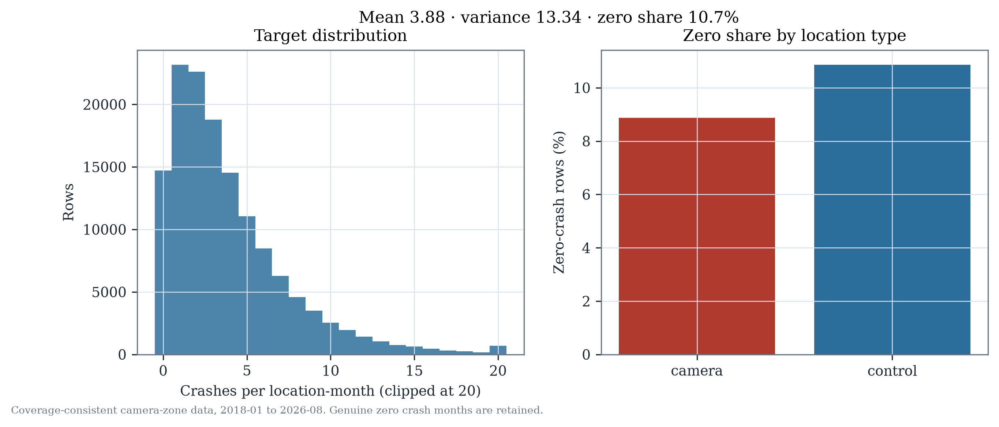
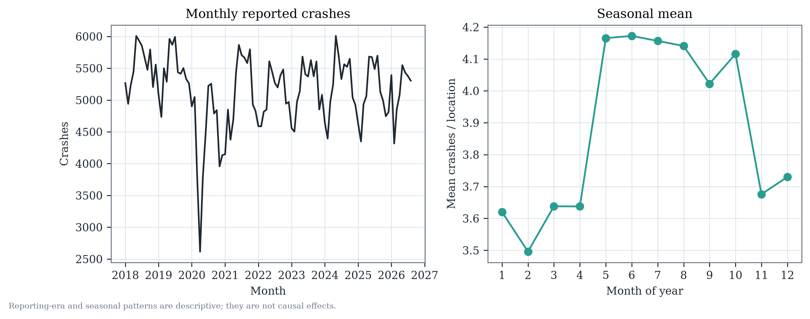
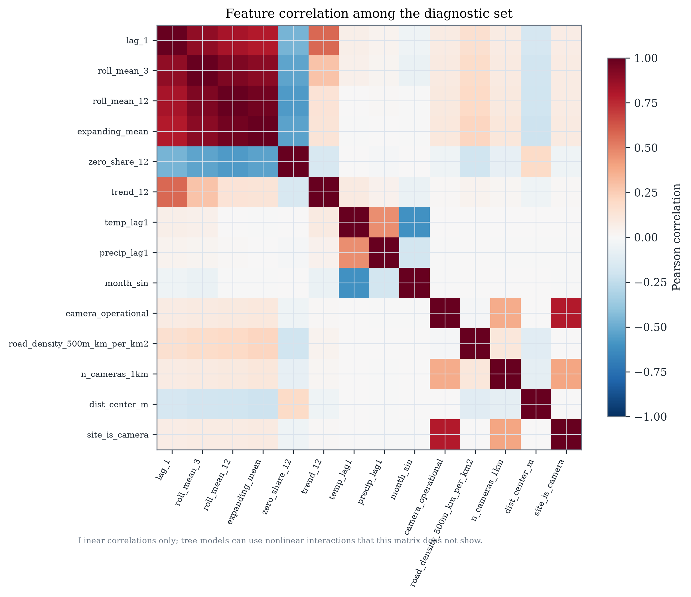
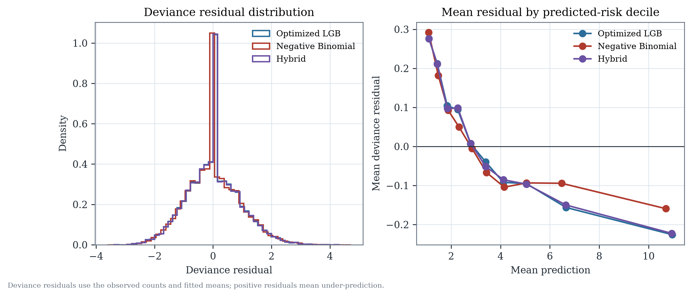
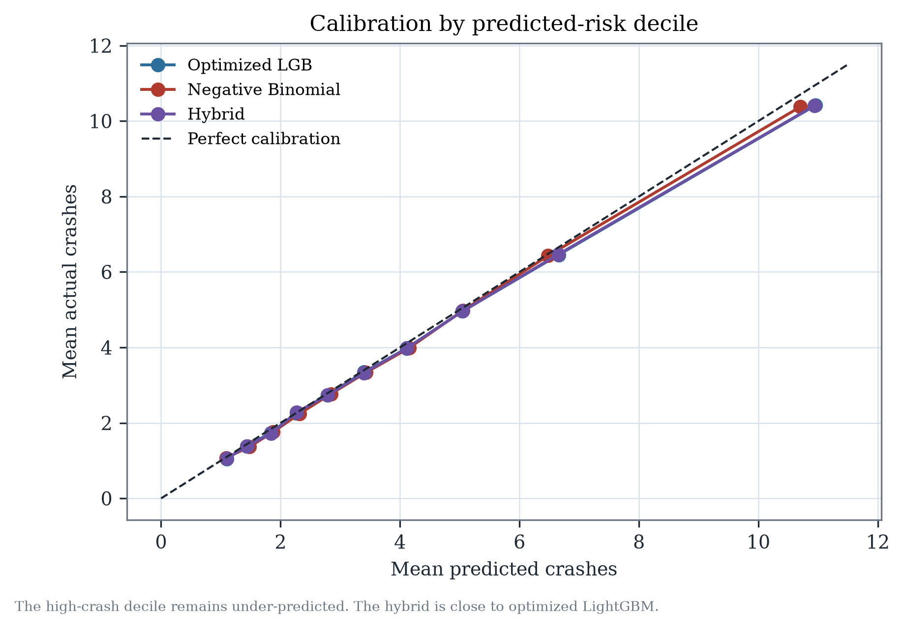

# Statistical diagnostics

**Data:** coverage-consistent camera-zone dataset, 137,904 location-months.
**Scope:** predictive diagnostics only; no causal interpretation.

---

## 1. Exploratory findings

| Diagnostic | Value |
|---|---:|
| Mean crashes per location-month | 3.881 |
| Variance | 13.341 |
| Variance / mean | 3.44 |
| Zero-crash share | 10.67% |
| Maximum month | 53 crashes |
| Camera-site mean / variance | 4.662 / 15.686 |
| Comparison-site mean / variance | 3.797 / 13.016 |
| Camera zero share | 8.88% |
| Comparison zero share | 10.87% |

The outcome is strongly overdispersed relative to Poisson. Zero months are
genuine observed zeros, not missing observations. The 2020 pandemic period is
visible as a low-count regime, not a data gap; monthly totals range from 2,616
(April 2020) to 6,008 (May 2024). Seasonal means are highest in May–August and
lowest in January–February.

## 2. Feature redundancy and multicollinearity

The 14-feature diagnostic matrix has three absolute correlations above 0.90:

| Feature pair | Correlation |
|---|---:|
| `roll_mean_3` vs `roll_mean_12` | 0.931 |
| `roll_mean_3` vs `expanding_mean` | 0.902 |
| `roll_mean_12` vs `expanding_mean` | 0.967 |

The Negative Binomial design deliberately keeps the historical scale information
but not every redundant lag. The highest VIFs in the fitted NB design are:

| Feature | VIF |
|---|---:|
| `temp_lag1` | 29.45 |
| `roll_mean_3` | 22.92 |
| `month_cos` | 16.95 |
| `roll_mean_12` | 13.29 |
| `lag_1` | 13.11 |
| `expanding_mean` | 11.10 |
| `month_sin` | 10.69 |
| `trend_6` | 9.71 |

These values justify **not** interpreting individual NB coefficients as isolated
effects. The model is used for forecasting only; correlated history features are
retained because they improve prediction and are not given causal readings.

## 3. Count-model dispersion

For the NB candidate, the Poisson Pearson dispersion on training data was used
to set the NB2 dispersion:

- training Pearson dispersion: **1.43**
- estimated NB2 alpha: **0.1038** for the final temporal fit
- fold alphas: 0.1117, 0.1074, 0.1054
- geographic alpha: 0.0562
- combined alpha: 0.0548

The likelihood is Negative Binomial with a log link and a historical-scale offset,
`log(expanding_mean + 0.5)`. The offset is available at the forecast origin.

## 4. Residual diagnostics

Test-period deviance residuals:

| Model | Mean | SD | 1st pct | 99th pct |
|---|---:|---:|---:|---:|
| Optimized LightGBM | 0.009 | 0.916 | −2.097 | 2.377 |
| Negative Binomial | 0.009 | 0.922 | −2.065 | 2.387 |
| Hybrid | 0.008 | 0.916 | −2.097 | 2.379 |

The mean residuals are near zero, but dispersion is large and the tails are
heavy. Mean lag-1 residual autocorrelation across locations is small:

- optimized LightGBM: **−0.089**
- Negative Binomial: **−0.105**
- hybrid: **−0.090**

Geographic cluster mean residuals range from about −0.10 to +0.14 for LightGBM
and from −0.09 to +0.15 for NB. The residual spread indicates remaining
location-specific variation not captured by the compact statistical design.

## 5. Zero, high-count and calibration diagnostics

| Model | Zero-crash MAE | Top-decile actual mean | Top-decile predicted mean | Top-decile MAE |
|---|---:|---:|---:|---:|
| Coverage-consistent V1 | 1.747 | 10.99 | 9.02 | 2.939 |
| Optimized LightGBM | 1.745 | 10.99 | 9.02 | 2.922 |
| Negative Binomial | 1.773 | 10.99 | 9.03 | 3.051 |
| Hybrid | 1.747 | 10.99 | 9.02 | 2.924 |

All candidates under-predict the highest-crash months. The NB is worse in the
high-count tail; the hybrid is almost identical to LightGBM. Calibration by
predicted-risk decile is close to the diagonal but below it at the high end.

## 6. Interpretation rules

- Do **not** apply OLS normality or homoskedasticity assumptions to LightGBM or
  NB count predictions.
- Do **not** interpret VIF as a reason to drop every correlated history feature;
  correlated history is the main predictive signal.
- AIC/BIC are reported only for the NB likelihood family and are not used to rank
  LightGBM against NB.
- Calibration and high-risk errors are reported separately from prospective
  hotspot ranking.
- No diagnostic here is a causal camera effect.
