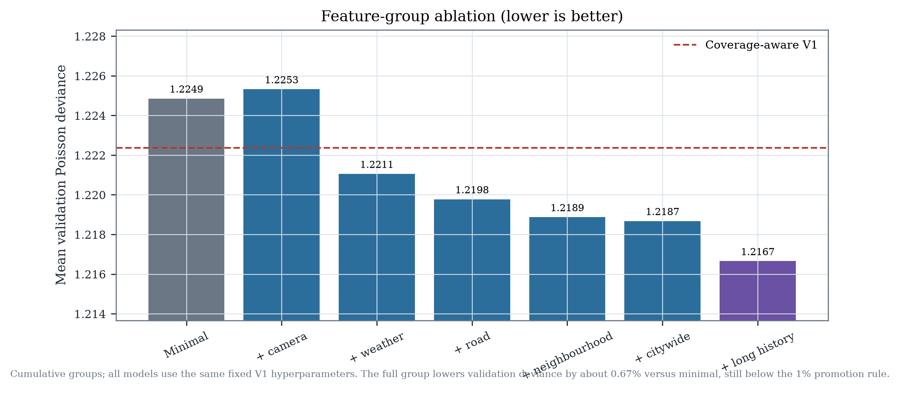
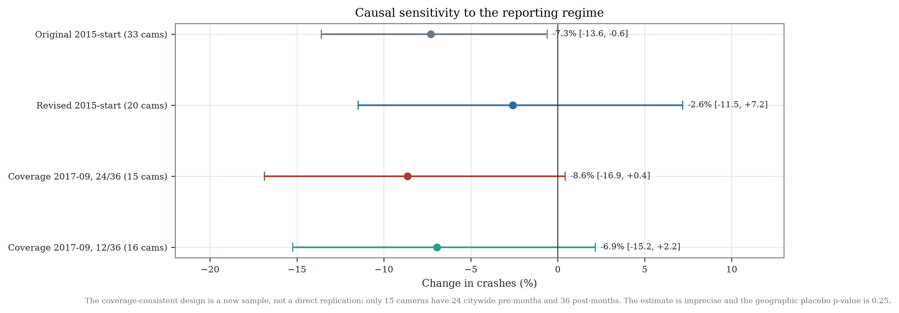

# Bottom-Up Reconstruction of the Chicago Speed-Camera Study

**Supplementary technical report · 27 October 2026**

**Co-authors:** Saketh Donepudi and Amrutha Kakumani

*This supplement does not replace the existing 21-page working paper. It records
what changed when the project was rebuilt from the raw public data, and what did
not change. It is not peer reviewed.*

---

## 1. Motivation

The original study treated 2015-09 as the start of usable crash data and trained
V1/V2 forecasts from 2017-01. Both choices were reasonable before the portal
metadata was checked. The current official description is explicit: E-Crash data
exist for some Chicago police districts in 2015, but citywide coverage is not
available until **September 2017**.

That changes the meaning of the early panel. It does not merely remove a few
sparse months. It changes the composition of reported crashes, the injury share,
the pre-treatment history available to later cameras, and the population on which
a model is trained. The reconstruction therefore starts with the reporting
process, not with a new LightGBM configuration.

The guiding rule is simple: do not make the analysis look stronger by treating
unobserved crashes as zeros, backfilling 2026 traffic exposure into 2017, or
comparing models trained on different populations as if their raw MAE ranked
them.

---

## 2. Reporting completeness

### 2.1 Official evidence

The Chicago Data Portal description for `85ca-t3if` states that citywide data are
not available until September 2017 and that records are added when a report is
finalized or amended. The portal does not expose a per-record finalization
timestamp. The current extract contains 1,107,461 rows; the preserved modeling
snapshot contains 1,106,882 rows. The current extract has 581 records added after
the snapshot and 2 records absent from it.

### 2.2 Empirical diagnostics

The raw monthly count rises from 7,685 in August 2017 to 9,038 in September 2017
(+17.6%). The injury share rises from 13.8% to 15.7%. Across the adjacent
twelve-month windows, mean monthly crashes rise from 5,382 to 9,817 and mean
injury share from 7.7% to 14.1%.

These are not interpreted as a real one-month safety shock. They are consistent
with the official reporting-regime change. All 22 CPD districts have at least one
record in every month from 2015-09 onward, including the pre-citywide period, so
district presence alone cannot measure completeness. That is why the reconstruction uses the
official metadata as the boundary and the monthly patterns only as corroborating
diagnostics.


### 2.3 Other record-level limits

- 8,673 snapshot rows have missing coordinates; 75 have zero coordinates; 8,748
  raw points fall outside the analysis bounding box.
- 240 records are marked `AMENDED`; no before/after versions are available.
- Notification delay (`date_police_notified − crash_date`) is short for most
  records: median 0.02 days, p95 2.53 days, p99 9.17 days; 0.17% exceed 30 days.
  This is not the same as portal finalization delay, which is unobservable.
- The last two source months (2026-09 and 2026-10) are marked incomplete; the
  model window ends 2026-08.

The two-month operating lag is retained as a conservative rule. It is not
presented as a measured publication lag.

---

## 3. Revised data construction

### 3.1 Coverage-consistent camera-zone dataset

The camera-zone design was rebuilt from `StudyData.subset_start("2017-09-01")`.
Controls were selected on the citywide period, not on the 2015–2017 partial
period. The target window starts in **2018-01**, allowing at least four months of
history before the first target month and avoiding a target month with no lag
structure.

| Statistic | Value |
|---|---:|
| Locations | 1,326 |
| Camera catchments | 129 |
| Comparison sites | 1,197 |
| Target months | 104 (2018-01…2026-08) |
| Rows | 137,904 |
| Zero-crash share | 10.7% |
| Mean crashes per location-month | 3.88 |
| Test rows | 15,912 (2025-09…2026-08) |

This is not the same task as V1/V2. V1/V2 start in 2017-01 and contain eight
months of partial reporting. The coverage-consistent model is compared on the
common test location-months, not by assuming identical training populations.

### 3.2 Road-segment dataset

The road design uses TIGER/Line 2024 EDGES clipped to the union of Chicago
community areas:

- 73,088 road segments; 3,126 major and 69,962 local.
- 6,659 km of road; median segment length 54.9 m.
- 98.9% of 2024 Cook segments existed as 2017 TLIDs; 6,633 older segments are
  absent and 795 are new.

Crashes are assigned once to the nearest segment within 30 m. Of 982,255 in-city
crashes, 975,033 (99.26%) are assigned; 7,222 are unassigned; 331,234 (34.0%)
have a second segment within 5 m and are flagged ambiguous; 2,214 (0.23%) are
more than 20 m from the chosen segment.

The modelling sample is all major segments plus 12,000 seeded random local
segments: 15,126 segments, 1,633,608 segment-months, 2,440 zero-crash segments,
and 23.6% of assigned crashes. This is a transparent sample, not a citywide road
census.

---

## 4. Geographic representation

The historical 250 m catchment is retained for comparability with the original
study. The road design is an additional prediction-oriented geography, not a
replacement for the causal design.

The two geographies answer different questions:

| Camera-zone | Road-segment |
|---|---|
| 250 m around a camera or comparison site | TIGER road segment |
| Crash-dense, non-random location set | All major segments + seeded local sample |
| 1,326 locations; 10.7% zeros | 15,126 sampled segments; 89.4% zeros |
| Connected to the causal analysis | Predictive only |
| No exposure denominator | No exposure denominator |

The 2024 road geometry is not treated as a perfect 2017 map. The TIGER 2017
comparison documents both continuity and missing older segments. Historical
road-network changes remain a limitation at block-face level.

---

## 5. Traffic exposure

The AADT dataset (`gc7y-n4xa`) does not support the 2017–2026 forecast:

- The portal description says data begin in October 2020 and quality improves
  from May 2026.
- The current extract actually begins in **July 2022**.
- It contains 2,525 segment IDs and 83,232 segment-months.
- 1,454 distinct 2024 road segments match within 50 m (2.0% of the 73,088 city
  segments).
- 199/209 camera locations have an AADT segment within 250 m, but the segment
  identity and time coverage are not sufficient for a historical merge.
- Counts are camera-derived; using them as an exogenous exposure denominator
  risks treatment-related measurement bias.

No 2017–2021 traffic denominator was manufactured. The final forecast remains
count-based, and the missing exposure is an explicit limitation. A normalized
crash rate is not reported for 2017–2021.


---

## 6. Model experiments

### 6.1 Declared protocol

Before the final test evaluation, the following selection rule was fixed:

- a new model may replace the deployed V1 only if validation Poisson deviance
  improves by at least **1%**;
- test MAE must not regress by more than **2%**;
- high-crash subgroup MAE must not regress by more than **2%**;
- geographic holdout and calibration must remain acceptable.

This is the existing V2 rule, retained. The coverage-consistent experiments do
not change the threshold after seeing results.

### 6.2 Feature ablation

All ablation models use the same fixed V1 hyperparameters, so differences are
attributable to feature groups.

| Model | Features | Validation deviance | Validation MAE |
|---|---:|---:|---:|
| M0 minimal | 34 | 1.2249 | 1.6104 |
| + camera operation | 37 | 1.2253 | 1.6103 |
| + weather | 43 | 1.2211 | 1.6068 |
| + road network | 56 | 1.2198 | 1.6054 |
| + neighbourhood | 62 | 1.2189 | 1.6045 |
| + citywide | 69 | 1.2187 | 1.6081 |
| + long history (full) | 78 | 1.2167 | 1.6059 |
| Coverage-aware V1 reference | 44 | 1.2224 | 1.6081 |

The full feature set lowers validation deviance by about **0.67%** versus the
minimal model. Road features add about 0.11% over the weather model;
neighbourhood and citywide features add smaller increments. Camera operation is
predictively redundant.



### 6.3 Optuna budget

The coverage-consistent full model was tuned with **8 Optuna trials** and a
600-second cap. The best validation deviance was 1.21647, a **0.48%** improvement
over coverage-aware V1 (1.22238), still below 1%. The tuned test deviance was
1.2162; test MAE 1.5775.

### 6.4 Road-segment experiment

The road model uses history, calendar and static road attributes; it omits AADT.
It achieves test MAE 0.182, Poisson deviance 0.395 and R² 0.351. Overall 90%
interval coverage is 90.3%, but the highest-risk decile is only **60.2%**.
Hotspot precision at the top 10% is 0.48 and recall 0.46.

These numbers are **not** comparable with camera-zone MAE. The road task has a
different unit, a different population, a 90% zero share, and 34% ambiguous
assignments.

---

## 7. Statistical evaluation

### 7.1 Common test rows

The deployed V1, V2 candidate and coverage-consistent models were evaluated on
the same 15,912 camera-zone test rows (12 months, 169 2 km blocks).

| Model | MAE | Poisson deviance | Bias | R² |
|---|---:|---:|---:|---:|
| Deployed V1 | 1.5860 | 1.2242 | +0.164 | 0.657 |
| V2 candidate | 1.5820 | 1.2193 | +0.145 | 0.659 |
| Coverage V1 | 1.5799 | 1.2201 | +0.119 | 0.659 |
| Coverage full | 1.5786 | 1.2175 | +0.130 | 0.659 |
| Coverage tuned | 1.5775 | 1.2162 | +0.127 | 0.660 |

Paired spatial-block bootstrap (1,000 draws over 169 blocks) gives a coverage-
tuned minus V1 deviance difference of **−0.0080** [−0.0114, −0.0043]. The
improvement is small and below the 1% promotion rule. V2 minus V1 deviance is
−0.0050 [−0.0080, −0.0018], also below 1%.

### 7.2 Temporal validation

Coverage V1 has fold mean deviance 1.2224 and MAE 1.6081. Coverage full has
1.2167 and 1.6059. The tuned model reaches 1.2165. The temporal folds are
2024-01…2024-06, 2024-07…2024-12 and 2025-01…2025-06.

### 7.3 Geographic holdout

A 2 km block holdout with a 1 km buffer was evaluated before the test period:
34 held-out blocks, 290 locations and 3,480 rows. Coverage V1 deviance is 1.2257;
coverage full is 1.2267. The richer model does **not** generalize better on this
geographic holdout.

### 7.4 Calibration and intervals

Coverage V1: 90% interval coverage 90.6% overall, 85.6% in the highest-risk
decile. Coverage full: 90.5% overall, 84.7% in the highest decile. Coverage tuned:
90.4% overall, 84.9% in the highest decile.

The high-risk interval undercoverage persists. It is not fixed by adding features
or tuning.

### 7.5 Hotspots and tails

Coverage tuned hotspot precision at the top 10% predicted is 0.72 and recall
0.55 using a training-derived high-crash threshold; lift is about 5.5. Zero-crash
months are over-predicted and high-crash months under-predicted. The model remains
a count forecaster, not a high-risk decision system.

---

## 8. Causal sensitivity

Causal inference remains independent of the forecasting model. The reporting
regime changes the pre-treatment history available to later cameras.

A strict coverage-consistent design requires 24 citywide pre-months and 36
post-months. This leaves **15 cameras** (go-live 2021-07…2023-07) and 5,400 panel
rows.

| Design | Cameras | Conditional Poisson | 95% CI | p | Cohort ATT | Pre-trend p |
|---|---:|---:|---|---:|---:|---:|
| Original notebook | 33 | −7.3% | [−13.6, −0.6] | 0.034 | — | — |
| Revised local 2015-start | 20 | −2.6% | [−11.5, +7.2] | 0.591 | −0.095 | 0.635 |
| Coverage 24/36 | 15 | −8.6% | [−16.9, +0.4] | 0.061 | −0.075 | 0.855 |
| Coverage 12/36 | 16 | −6.9% | [−15.2, +2.2] | 0.131 | −0.008 | 0.507 |
| Coverage 24/24 | 18 | −6.6% | [−14.3, +1.7] | 0.115 | +0.372 | 0.791 |

The strict coverage estimate is more negative than the revised 2015-start
estimate, but it is a different sample and remains compatible with zero. The
geographic placebo one-sided p-value is 0.25; the estimate sits inside the
placebo distribution. The 24/36 cohort estimate is −0.075 [−0.773, +0.605]
crashes/site-month.



This does not establish a stronger camera effect. It demonstrates that the
reporting regime is material to the estimand and that the public data cannot
resolve the effect at policy precision.

---

## 9. Final model decision

| Candidate | Validation deviance | Test deviance | High-risk interval coverage | Geographic holdout | Decision |
|---|---:|---:|---:|---:|---|
| Deployed V1 | 1.2227 | 1.2233* | 84.8% | — | **Keep deployed** |
| V2 candidate | 1.2197 | 1.2181* | 84.8% | 1.2189 | Research candidate |
| Coverage V1 | 1.2224 | 1.2201† | 85.6% | 1.2257 | Research reference |
| Coverage full | 1.2167 | 1.2175† | 84.7% | 1.2267 | Not selected |
| Coverage tuned | 1.2165 | 1.2162† | 84.9% | — | Not selected |
| Road segment | 0.4043 | 0.3949† | 60.2% | — | Separate task |

\* V1/V2 test values are their original retrospective test evaluation (16,260
rows). † Common 15,912-row evaluation. The table mixes populations only where
explicitly marked; raw MAE across camera-zone and road tasks is not comparable.

The deployment decision does not change:

- V1 remains deployed.
- V2 remains a research candidate under the pre-declared 0.243% validation gain.
- The coverage-tuned model is retained as a research artifact; it does not meet
  the 1% rule and does not improve geographic holdout.
- The road-segment model is not selected for the camera-zone task.

---

## 10. Implications

1. **The publication's forecasting test is not independent of the reporting
   regime.** V1/V2 start eight months before citywide coverage. This should be
   disclosed and, where feasible, a coverage-consistent sensitivity should be
   added.
2. **The revised causal estimate is not the only defensible estimate.** A
   citywide pre-period design yields a more negative but imprecise estimate on a
   much smaller cohort. Neither estimate should be described as definitive.
3. **Exposure remains the largest missing measurement.** AADT cannot supply a
   historical denominator, and camera-derived counts are not exogenous.
4. **Road segments are a useful separate task, not a replacement task.** The
   road model has a 90% zero share and 34% assignment ambiguity; its raw MAE is
   not a better camera-zone score.
5. **More features are not the main lever.** The full feature set improves
   validation deviance by 0.67% over minimal; the 1% rule is not met.
6. **Test-period reuse.** The 2025-09…2026-08 period was already inspected in V1.
   Every coverage-consistent and V2 test result reported here is retrospective,
   not a new untouched confirmation.

---

## Appendix A — Artifacts

Coverage:

- `results/bottom_up/coverage/summary.json`
- `results/bottom_up/coverage/monthly_coverage.csv`
- `results/bottom_up/coverage/district_month_coverage.csv`
- `results/bottom_up/coverage/beat_month_coverage.csv`

Exposure:

- `results/bottom_up/exposure/summary.json`
- `results/bottom_up/exposure/aadt_monthly_coverage.csv`
- `results/bottom_up/exposure/aadt_availability_matrix.parquet`
- `results/bottom_up/exposure/aadt_road_match.json`

Road design:

- `data/processed/road_segments.parquet`
- `data/processed/crash_road_assignments.parquet`
- `data/processed/road_segment_month_counts.parquet`
- `data/processed/road_model_panel_features.parquet`
- `results/bottom_up/roads/`

Models:

- `results/bottom_up/coverage_model/`
- `results/bottom_up/road_model/`
- `models/bottom_up/`

Causal:

- `results/bottom_up/coverage_causal/`

Figures:

- `results/bottom_up/figures/`

## Appendix B — Reproduction

```bash
python -m chicago_cameras.coverage
python -m chicago_cameras.exposure
python -m chicago_cameras.road_network
python -m chicago_cameras.ml.coverage_dataset
python -m chicago_cameras.ml.reconstruction
python -m chicago_cameras.ml.tune_coverage
python -m chicago_cameras.ml.road_model
python scripts/make_bottom_up_figures.py
```

The original publication branch, 21-page paper, V1/V2 artifacts and LinkedIn
drafts remain intact. No DOI, release, deployment or peer-review claim is added.
