# Do Speed Cameras Make Chicago Safer? A Geospatial Causal Inference and Machine Learning Study

**Saketh Donepudi and Amrutha Kakumani**

*Working paper · October 2026 · Not peer reviewed*

*Affiliations and individual contribution roles are pending confirmation by both co-authors. No institutional endorsement is claimed.*

---

## Abstract

Speed cameras are installed where crashes are already high, so naive before/after comparisons confound enforcement with mean reversion, local trends and city-wide shocks. This paper reports a reproducible study of Chicago's automated speed enforcement program using public crash records from 2015-09 to 2026-08. Citywide reporting begins only in September 2017. The causal design compares 250 m camera catchments with nearby matched sites, removes overlapping camera catchments, and uses conditional Poisson fixed effects and a cohort 2×2 estimator. The original notebook's −7.3% estimate (95% CI −13.6% to −0.6%) reproduces exactly, but it depends on citywide matching that the documentation did not describe and retains overlapping cameras. Under local 2,000 m matching with overlap removal, the estimate is −2.6% (−11.5% to +7.2%; p = 0.59) across 20 cameras. A coverage-consistent design that requires 24 citywide pre-months and 36 post-months leaves 15 cameras and gives −8.6% (−16.9% to +0.4%; p = 0.061), with a geographic placebo p-value of 0.25; this is a different sample, not a direct replication. A separate LightGBM system forecasts monthly crashes at 1,355 crash-dense locations. V1 achieves held-out MAE 1.568, RMSE 2.093 and Poisson deviance 1.223; an 84-feature V2 improves retrospective deviance by 0.4% and fails a pre-declared 1% promotion rule. A coverage-tuned model improves deviance by 0.65% on 15,912 common test rows—also below the rule—so V1 remains deployed. Approximate 90% conformal intervals cover 90.6% of V1 test rows but only 84.8% of the highest-risk decile. Traffic AADT is excluded because the public series begins in 2022-07 and covers only 2,525 segments. The central lesson is that the answer to "do cameras work?" is highly sensitive to spatial and reporting design, and that forecasting accuracy is not causal identification.

**Keywords:** automated speed enforcement; difference-in-differences; staggered adoption; synthetic control; conformal prediction; LightGBM; road safety; reproducibility.

---

## 1. Introduction

Chicago began automated speed enforcement in school and park safety zones in 2013 and expanded the program substantially in later years. The policy question is simple to state and difficult to answer: do cameras reduce crashes? A simple comparison of crash counts before and after activation is not informative, because cameras are deliberately placed at locations with high crash histories. Crashes at those locations tend to fall even without a camera—regression to the mean—and city-wide changes such as the COVID-19 pandemic move every location at once.

This paper asks two related questions. First, can the observed association between cameras and crashes be interpreted causally, and how sensitive is the estimated effect to geographic matching, treatment timing and research design? Second, how accurately can a single LightGBM model forecast location-level crash counts, and where does it fail? The two analyses are deliberately separate. A prediction model estimates expected crashes under observed patterns; it does not estimate the counterfactual effect of installing or removing a camera.

The study makes three modest contributions: a reproducible audit that exactly reproduces the −7.3% estimate and shows it is not robust to defensible design changes; conditional Poisson and cohort 2×2 estimators that avoid negative weighting under staggered adoption; and a geographically validated forecasting layer with conformal uncertainty that is explicitly not causal evidence.

The headline result is not a new national estimate of camera effectiveness. It is a statement about design sensitivity: the same public data, with plausible changes to matching and overlap handling, move the estimate from a statistically significant −7% to a wide interval that includes zero. That is the most defensible finding the data support.

---

## 2. Related work

The road-safety literature generally finds reductions in collisions and casualties near speed cameras, with weaker evidence on wider-area effects and severity. Pilkington and Kinra (2005) emphasize study quality and regression to the mean; Wilson et al. (2010) find the strongest evidence for fatal and serious injuries; Graham et al. (2019) study London and note displacement and heterogeneity.

Chicago-specific evidence is most relevant. Tilahun (2023) uses an empirical Bayes design at 101 camera locations and reports a 12% reduction in fatal and injury crashes for 2015–2017, and 15% for fatality and severe injury. Sutton and Tilahun (2022) examine the program's equity and efficacy. These studies evaluate the earlier 2013–2014 rollout; this paper evaluates later cohorts and asks how sensitive the answer is to design.

The closest recent quasi-experimental comparison is New York City. Stagoff-Belfort, Ben-Menachem and Beck (2025) exploit the staggered rollout of roughly 2,000 cameras between 2014 and 2023 and estimate reductions of about 5% per month for collisions and 2.5% per month for injuries, cumulatively about 30% and 16% over seven months. The magnitudes are larger than our revised Chicago estimate, but the programs, outcomes, periods and designs differ.

Methodologically, Bertrand, Duflo and Mullainathan (2004) show that naive standard errors are understated under serial correlation. Goodman-Bacon (2021) and de Chaisemartin and D'Haultfœuille (2020) show that two-way fixed-effects estimands can place negative weights on staggered 2×2 comparisons; Callaway and Sant'Anna (2021) and Sun and Abraham (2021) provide group-time and event-study alternatives. Abadie, Diamond and Hainmueller (2010) develop synthetic control; Cameron, Gelbach and Miller (2008) provide small-cluster bootstrap inference; Barnett (2005) and Hauer (1997) document regression to the mean.

| Study | Geography | Period | Outcome | Design | Estimated effect |
|---|---|---|---|---|---|
| Tilahun (2023) | Chicago | 2015–2017 | Fatal/injury; fatal/severe | Empirical Bayes, 101 locations | −12% fatal/injury; −15% fatal/severe |
| Stagoff-Belfort et al. (2025) | New York City | 2014–2023 | Collisions and injuries | Staggered DiD, ~2,000 cameras | −5%/month collisions; −2.5%/month injuries |
| Sutton & Tilahun (2022) | Chicago | 2016–2019 | Equity/efficacy | Empirical Bayes report | Report-level estimates |
| **This study** | **Chicago** | **2015–2026** | **All reported crashes** | **Matched DiD; conditional Poisson FE; cohort 2×2** | **−2.6% [−11.5%, +7.2%]** |

Total-crash and injury-crash effects are not directly comparable: cameras may affect severe outcomes differently, and reporting completeness differs across data systems. This study does not disprove the Chicago or New York findings; it estimates a different sample with a different design and reports more uncertainty.

---

## 3. Data and study setting

All data are public: crashes from the Chicago Data Portal *Traffic Crashes – Crashes* (`85ca-t3if`), camera locations and go-live dates from *Speed Camera Locations* (`4i42-qv3h`), and enforcement counts from *Speed Camera Violations* (`hhkd-xvj4`). The snapshot was acquired on 2026-10-24; raw records retain query parameters, timestamps and SHA-256 checksums.

The cleaned crash table contains 1,080,998 records from 2015-09 to 2026-08. The portal has only 476 records in 2015-01…08 and 8 in 2013–14; those months are missing, not observed zeros. The last two source months are excluded because reports are still arriving. The coverage guard removes sparse leading months, but it does **not** make 2015-09…2017-08 citywide: the portal states that E-Crash data are available for some districts in 2015 and citywide coverage begins in September 2017. The publication causal panel begins in 2015-09, the V1/V2 forecast target begins in 2017-01, and the coverage-consistent reconstruction uses 2017-09 history and 2018-01 targets. These are different samples and are not interchangeable.

| Period | Mean monthly crashes | Mean injury share |
|---|---:|---:|
| 2016-09…2017-08 | 5,382 | 7.7% |
| 2017-09…2018-08 | 9,817 | 14.1% |

The break is shown in Figure 9, placed with the forecasting figures.

The outcome is reported crashes within 250 m of a location in a calendar month, not crashes per vehicle-mile. The public AADT extract begins in July 2022, not October 2020, and contains 2,525 segments and 83,232 segment-months; 1,454 distinct 2024 road segments match within 50 m. It cannot supply a historical 2017–2021 denominator, and its camera-derived counts are not exogenous. Traffic volume is therefore excluded from the forecasting model and the causal estimand.

### Study setting

Chicago's program operates in school and park safety zones. The portal records a go-live date but not warning-period end, camera uptime or enforcement hours. We treat the go-live month as the first treated month; a sensitivity analysis starts treatment in the following month. Cameras are sited at locations selected for crash history and school/park proximity; placement is not random.

---

## 4. Causal identification strategy

The estimand is the average effect of camera enforcement on reported crashes per catchment-month for cameras with complete windows. Identification requires that, absent the camera, camera catchments and their matched comparison sites would have followed the same trend (parallel trends), that drivers do not anticipate treatment, that cameras do not affect comparison sites, and that camera siting is not driven by unobserved time-varying local shocks.

The last assumption is the weakest. Cameras are placed where crashes were high, so regression to the mean remains a threat even after matching on pre-period level and slope. Placebo go-live dates and geographic placebos test for some forms of this bias but cannot eliminate it.

The design proceeds in five steps.

1. **Catchments.** A camera's catchment is a 250 m radius around its reported coordinate.
2. **Comparison sites.** A 500 m lattice is screened for ≥100 crashes and ≥40% active months, at least 600 m from every camera (more than twice the treatment radius).
3. **Matching.** Each camera gets five sites within 2,000 m, matched on pre-period level and slope in its own pre-window. The 1,000 m alternative leaves only 11 of 33 cameras with five controls; citywide matching reproduces the original behavior.
4. **Overlap.** A camera overlapping an already-live camera is removed: 34,222 crashes (36.3%) fall inside two or more catchments. The primary design drops 13 of 33 eligible cameras.
5. **Event time.** The panel runs from 24 months before to 35 months after go-live. The go-live month is month 0.

The replication sample has 33 cameras and 11,880 panel rows; the primary sample has 20 cameras and 7,200 rows. Pre-period balance is good: standardized mean difference in crash level 0.14; differential pre-trend +0.007 crashes/site-month per month (95% CI −0.022 to +0.036; p = 0.62).

### 4.6 Coverage-consistent design

Because the publication pre-period straddles the reporting transition, we also require all 24 pre-months and 36 post-months to fall after 2017-09. This leaves **15 cameras** (go-live 2021-07…2023-07) and 5,400 panel rows. The design is otherwise the same local 2,000 m, overlap-removed specification. It is a new estimand on a much smaller cohort, not a replication of the 20-camera estimate. A 12-month pre-period extension yields 16 cameras; a 24-month post-period yields 18. The joint pre-trend p-value is 0.855, and the geographic placebo one-sided p-value is 0.25.

### What changed between the original and revised estimates

The original README required comparison sites within 1,000 m, but the code selected the five nearest matches citywide. It also retained overlapping catchments and used a flat degrees-to-metres approximation. The revised design uses UTM metres, local matching, overlap removal and a coverage guard. These are design corrections, not arithmetic corrections: the original numbers reproduce exactly.

---

## 5. Geospatial matching and treatment definition

Distances are computed in NAD83 / UTM zone 16N (EPSG:26916), with validation against great-circle distances. All site-months are retained, including genuine zeros. A crash is counted at most once per site; repeated attribution across overlapping camera catchments is measured and removed from the primary sample.

The 500 m lattice is a proxy for road exposure. It is not a road network. Candidate sites are screened by crash volume and active-month share, and the analysis reports posted-speed-limit balance (both camera and comparison catchments have a median of 30 mph). The lattice phase is arbitrary; the primary estimate ranges from −3.07% to −1.20% across four phases, while the citywide replication ranges from about −5.0% to −8.5%. Local matching is less phase-sensitive, which is one reason it is preferred.

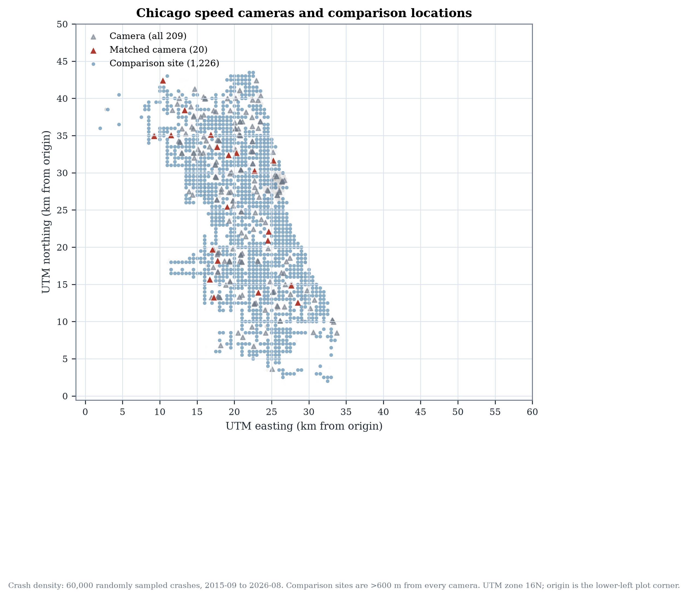

*Figure 1. Chicago camera locations and matched comparison sites. Comparison sites are more than 600 m from every camera. Crash density is a 60,000-record sample.*

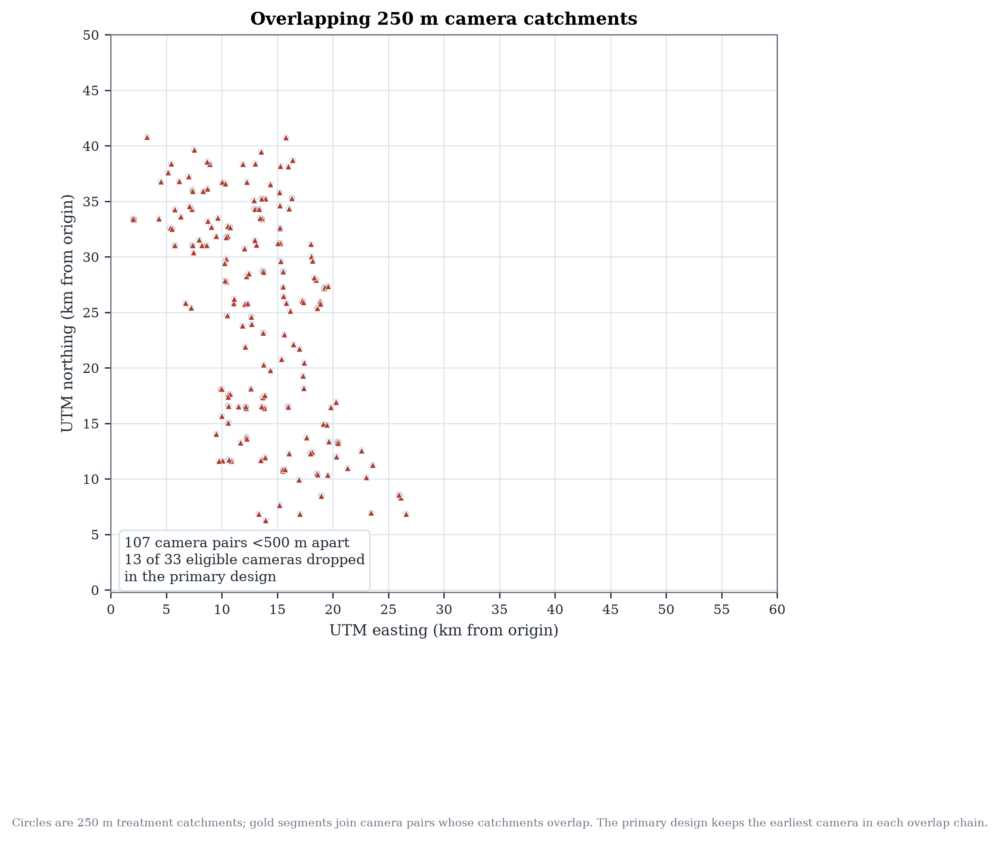

*Figure 2. Overlapping 250 m camera catchments. Gold segments join pairs less than 500 m apart; the primary design keeps the earliest camera in each overlap chain.*

---

## 6. Statistical models

### 6.1 Stacked difference-in-differences

The baseline specification mirrors the original notebook:

\[
y_{ist} = \alpha + \beta\,\text{treated}_i + \gamma\,\text{post}_{st} + \tau\,(\text{treated}_i \times \text{post}_{st}) + \varepsilon_{ist},
\]

estimated by OLS and Poisson with standard errors clustered by camera stack. This specification is retained as a baseline, not as the preferred causal model.

### 6.2 Conditional Poisson fixed effects

The preferred count model conditions on each camera-month total. Let \(y_{0st}\) be the treated count and \(y_{1st}\) the sum over the five comparison sites. Conditional on \(N_{st}=y_{0st}+y_{1st}\),

\[
y_{0st} \mid N_{st} \sim \text{Binomial}\left(N_{st}, \frac{\exp(\alpha_{st}+\tau \text{post}_{st})}{\exp(\alpha_{st}+\tau \text{post}_{st})+5}\right),
\]

which is the exact conditional likelihood of a Poisson model with a full set of camera-by-month fixed effects. The coefficient \(\tau\) is a log rate ratio; \(\exp(\tau)-1\) is the percent change. This absorbs every shock shared by a camera and its comparison sites, including citywide traffic and COVID-19.

### 6.3 Cohort 2×2 estimator

For each camera \(i\) and event month \(e \ge 0\),

\[
\widehat{ATT}_i(e) = (Y_{i,g_i+e}-Y_{i,g_i-1}) - \frac{1}{5}\sum_{j \in \mathcal{C}_i}(Y_{j,g_i+e}-Y_{j,g_i-1}),
\]

where \(g_i\) is go-live and \(\mathcal{C}_i\) are matched controls. The camera-level effect averages over \(e=0,\dots,35\); the overall effect averages across cameras. Inference is a percentile bootstrap that resamples cameras, respecting the small number of independent treated units.

### 6.4 Event study

Quarterly treated-by-event-time indicators are estimated with unit and camera-by-event-month fixed effects, reference quarter −1. The joint pre-trend Wald statistic uses the cluster-robust covariance. A pre-trend test can fail to reject; it cannot prove parallel trends, and with 15–20 cameras it has low power.

### 6.5 Synthetic control

The largest go-live cohort (seven cameras, March 2023) is fitted to a de-meaned convex combination of 100 comparison sites, chosen on pre-period fit. Inference uses 200 placebo-in-space draws. A pre-fit gate (R² < 0.50) prevents a weakly fitting synthetic control from being presented as evidence.

---

## 7. Causal results

### 7.1 Replication

The original logic reproduces exactly on the current snapshot: 33 cameras, 11,880 panel rows, pre-period means 4.298 (comparisons) and 4.403 (cameras), OLS −0.3557 [−0.7110, −0.0005], p = 0.0497; Poisson −7.3% [−13.6%, −0.6%], p = 0.0342. The saved notebook outputs are not artifacts of a different data extract.

Applying the corrected projection to the same 33-camera sample gives −8.58% [−14.66%, −2.07%], p = 0.0105. The projection matters, but the larger change comes from local matching and overlap removal.

### 7.2 Primary estimates

| Estimator | Effect | 95% CI | p |
|---|---:|---:|---:|
| Naive before/after | +4.7% | — | — |
| Stacked OLS (original formula, primary sample) | −0.069 crashes/site-month | [−0.428, +0.289] | 0.71 |
| Stacked Poisson (original formula, primary sample) | −2.6% | [−11.5%, +7.2%] | 0.59 |
| FE OLS (unit + camera-month FE) | −0.069 | [−0.493, +0.354] | 0.74 |
| **Conditional Poisson FE** | **−2.6%** | **[−11.5%, +7.2%]** | **0.59** |
| Cohort 2×2 | −0.095 | [−0.735, +0.520] | 0.79 |
| Wild cluster bootstrap p (FE OLS) | — | — | 0.72 |

The naive comparison increases crashes by 4.7%, illustrating selection. The controlled estimates are negative but imprecise. The interval is compatible with a reduction of roughly one in nine crashes and an increase of roughly one in fourteen. With 20 treated units and shared comparison sites, the design cannot resolve modest effects.

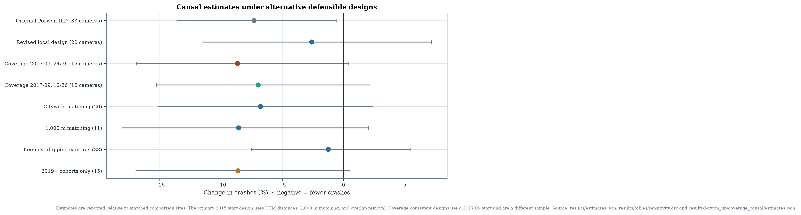

*Figure 3. Causal estimates under alternative defensible designs, with 95% confidence intervals.*

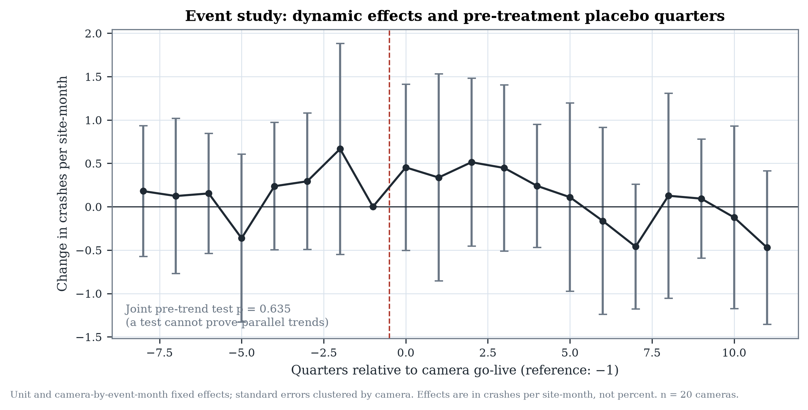

*Figure 4. Quarterly event-study effects relative to the quarter before go-live.*

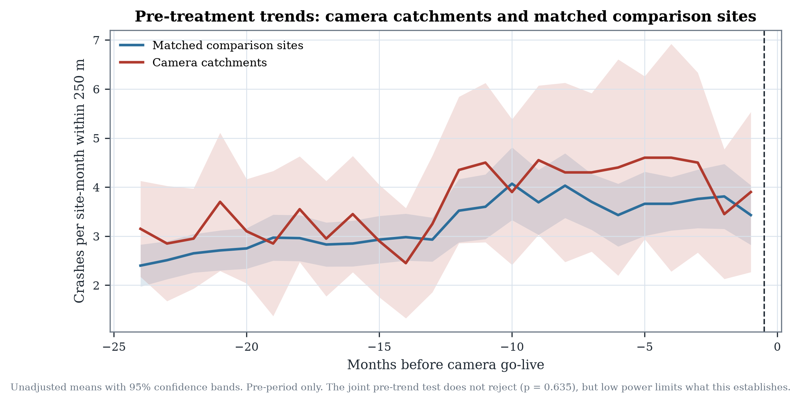

*Figure 5. Pre-treatment crash trends for camera catchments and matched comparison sites.*

### 7.3 Coverage-consistent estimate

The strict 2017-09 design gives **−8.6%** (95% CI −16.9% to +0.4%; p = 0.061) across 15 cameras. The cohort 2×2 estimate is −0.075 crashes/site-month [−0.773, +0.605]. With a 12-month pre-period and 36-month post-period, 16 cameras give −6.9% [−15.2%, +2.2%]; the 24/24 window gives −6.6% on 18 cameras. These estimates are imprecise and the strict design is mostly the 2023 cohort. The geographic placebo distribution places the strict estimate at p = 0.25. The result shows that the reporting regime is material to the estimate; it does not establish a stronger camera effect.

### 7.4 Synthetic control

The synthetic control for the 2023-03 cohort has pre-period R² 0.742 and pre-RMSPE 0.706 against a pre-mean of 3.41, a moderate fit. Its post-period gap is +4.2% (more crashes than the synthetic counterfactual), with a placebo-in-space pseudo-p of 0.495 for a negative gap. It does not corroborate the DiD. The disagreement is reported as an unresolved inconsistency, not as confirmation.

---

## 8. Robustness and sensitivity analysis

| Specification | Cameras | Effect (%) | 95% CI | p |
|---|---:|---:|---|---:|
| Baseline (250 m, 2 km) | 20 | −2.6 | [−11.5, 7.2] | 0.59 |
| Radius 150 m | 21 | +0.5 | [−8.0, 9.8] | 0.91 |
| Buffer 500 m | 20 | −2.8 | [−11.0, 6.3] | 0.54 |
| 3 matched controls | 20 | −2.2 | [−11.5, 8.0] | 0.65 |
| 1,000 m matching | 11 | −8.6 | [−18.1, 2.1] | 0.11 |
| Citywide matching | 20 | −6.8 | [−15.2, 2.4] | 0.14 |
| Window −12/+36 | 20 | −4.5 | [−12.3, 3.9] | 0.28 |
| Window −24/+24 | 23 | −2.1 | [−10.1, 6.7] | 0.63 |
| Window −24/+48 | 6 | +2.3 | [−13.4, 20.9] | 0.79 |
| COVID exclusion | 20 | −0.5 | [−10.6, 10.7] | 0.93 |
| Injury crashes only | 20 | −2.1 | [−19.4, 18.8] | 0.83 |
| Severe/fatal only | 20 | +11.6 | [−20.2, 55.9] | 0.52 |
| Lattice phase range | 20 | −3.1 to −1.2 | — | — |
| Keep overlapping cameras | 33 | −1.3 | [−7.5, 5.4] | 0.71 |
| 2015–2018 cohorts | 5 | +9.8 | [−6.0, 28.3] | 0.24 |
| 2019+ cohorts | 15 | −8.6 | [−16.9, 0.5] | 0.06 |
| Coverage 2017-09, 24/36 | 15 | −8.6 | [−16.9, 0.4] | 0.061 |
| Coverage 2017-09, 12/36 | 16 | −6.9 | [−15.2, 2.2] | 0.131 |

Two patterns stand out. Local versus citywide matching is the largest design lever: citywide matching gives about −7%, local matching about −3%. The era split is the most suggestive heterogeneity: later cohorts show a larger reduction than the 2015–2018 cohorts. That split is consistent with either a genuinely stronger effect for later installations or contamination from the 2017 crash-reporting transition; the public data cannot separate them. The original sample plus original design is the only specification that is clearly statistically significant, and it is the least defensible.

Placebo tests place the real estimate near the middle of the geographic placebo distribution (one-sided p = 0.53 for the DiD and 0.38 for the cohort estimator). Placebo go-live dates (−24 and −12 months) produce estimates close to zero. Lattice phase and radius/buffer changes move the local estimate by only about two percentage points.

### Interpretation: a non-significant estimate is not proof of zero effect

The 95% interval for the primary estimate spans −11.5% to +7.2%. It includes both a policy-relevant reduction and a modest increase. The correct conclusion is that the data are insufficient to resolve the question at the precision policy requires, not that cameras have no effect. This distinction is central to the paper.

---

## 9. Crash forecasting using LightGBM

Forecasting asks a different question: expected reported crashes at a location in the next calendar month, conditional on prior history and covariates. V1/V2 use 129 camera catchments and 1,226 comparison sites (1,355 locations; 157,180 location-months, 2017-01…2026-08). That target includes eight months before citywide reporting, so we also build a coverage-consistent dataset starting in 2017-09 with targets from 2018-01.

### 9.1 Features

V1 uses 44 features: calendar and holidays; crash lags 1/2/3/6/12; rolling means and standard deviations; expanding statistics; zero, injury and severe shares; trend; lagged weather; static geography; and camera operational context. V2 adds 40 features: 24/36-month lags, seasonal ratios, shocks, months since crash/injury, citywide regime features, Gaussian-kernel neighbourhood history, and 2024 TIGER road density, class and intersection features. No XGBoost, CatBoost, random forest or neural network is trained.

No traffic-volume feature is used. The public AADT extract begins in July 2022 and contains 2,525 segments; using it for 2017–2025 would either leak future exposure or require fabricated backfills. The earlier 2006 study is too old and sparse.

### 9.2 Leakage, validation and coverage

All history features are shifted by at least one month; rolling windows look backwards; weather is lagged. Mechanical checks recompute lags and perturb future outcomes, and inference validates the saved schema. The test period 2025-09…2026-08 was locked before tuning. Temporal validation uses three expanding six-month folds (2024-03…2025-08); geographic validation holds out 34 of 169 two-kilometre blocks and removes training locations within 1 km of a held-out location.

The coverage-consistent camera-zone dataset contains 1,326 locations (129 camera, 1,197 comparison) and 137,904 location-months from 2018-01 to 2026-08. Its zero share is 10.7% and mean crashes per location-month is 3.88. It is not the V1/V2 population.

A separate road-segment task uses 73,088 TIGER/Line 2024 segments; the modelling sample is all 3,126 major segments plus 12,000 seeded local segments (15,126 segments; 1,633,608 segment-months; 89.4% zeros). Crashes are assigned once within 30 m: 99.26% assigned, but 34.0% have a second segment within 5 m. This task is predictive only and not comparable to the camera-zone task.

---

## 10. Prediction evaluation and uncertainty

### 10.1 V1 versus V2

| Metric | V1 (deployed) | V2 candidate |
|---|---:|---:|
| Test MAE | 1.5683 | **1.5642** |
| Test RMSE | 2.0931 | **2.0888** |
| Test Poisson deviance | 1.2233 | **1.2181** |
| Test bias | +0.163 | **+0.144** |
| Test R² | 0.6611 | **0.6624** |
| Zero-crash MAE | 1.718 | **1.698** |
| High-crash MAE (top decile) | **2.897** | 2.922 |
| Validation deviance | 1.2227 | **1.2197** |

V2 improves validation deviance by only 0.24%, below the pre-declared 1% rule, and regresses slightly on the highest-crash decile. V1 remains deployed. V2 does improve geographic-holdout deviance (1.2189 vs 1.2328) and recursive 12-month MAE (1.6231 vs 1.6452), so it is retained as a research candidate.

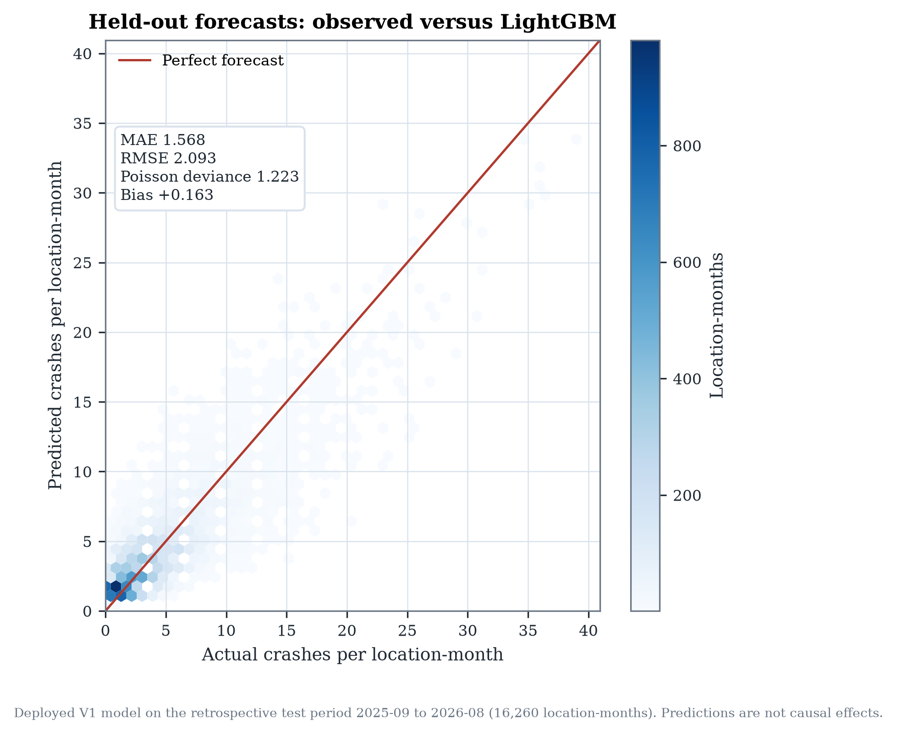

*Figure 6. Deployed V1 forecasts against observed crashes on the retrospective test period.*

### 10.2 Calibration and intervals

The model over-predicts zero-crash months and under-predicts high-crash months. V1's top actual-crash decile has mean actual 10.99 and mean predicted 9.02; the coverage-tuned model has mean predicted 9.02 and MAE 2.922 (V1 2.897). Zero-crash MAE is 1.72 for V1 and 1.745 for coverage-tuned.

Split-conformal intervals use the scale-normalised score \(|y-\mu|/\sqrt{\mu+1}\), calibrated on out-of-fold rolling predictions. V1 coverage is **90.6%** overall, 90.1% at camera sites and 90.7% at comparison sites; the highest-risk decile is **84.8%**. Coverage-tuned coverage is 90.4% overall and 84.9% in the highest decile. Intervals are approximate and not causal confidence intervals.

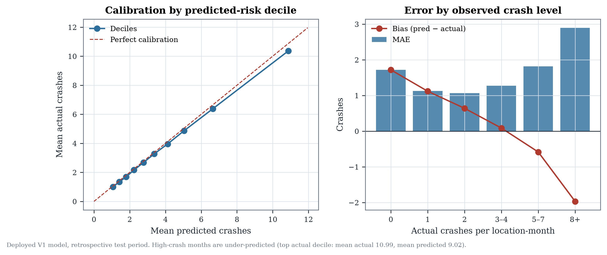

*Figure 7. Calibration by predicted-risk decile and error by observed crash level for the deployed V1 model.*

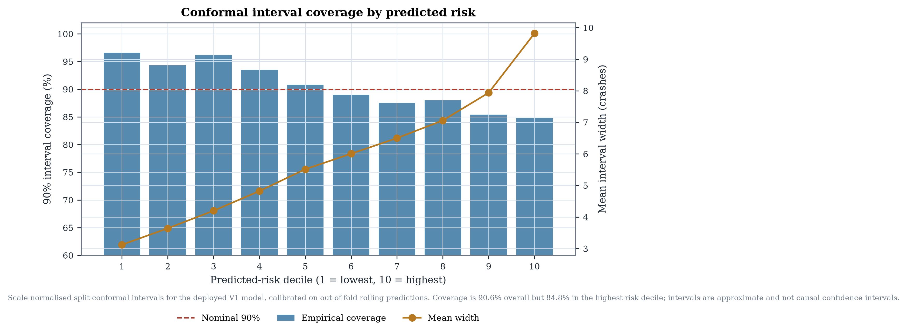

*Figure 8. Conformal 90% interval coverage by predicted-risk decile for deployed V1.*

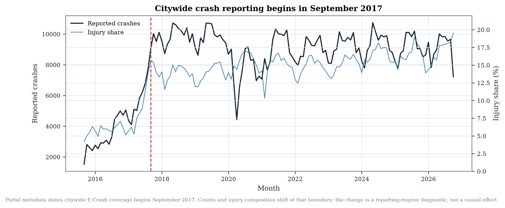

*Figure 9. The September 2017 citywide reporting break. All 22 CPD districts have at least one record in every month from 2015-09 onward, so district presence alone is not a completeness measure.*

### 10.3 Coverage-consistent comparison

The coverage-tuned model (78 features, 8 Optuna trials) reaches test MAE 1.5775 and deviance 1.2162 on the same 15,912 common rows, versus V1 1.5860 and 1.2242. Its validation deviance 1.2165 is 0.48% better than coverage V1—below the 1% rule. The paired spatial-block bootstrap deviance difference is −0.0080 [−0.0114, −0.0043]. It is slightly worse than coverage V1 on the geographic holdout (1.2267 vs 1.2257), so it is not deployed.

| Common test model | MAE | Deviance | Bias | R² |
|---|---:|---:|---:|---:|
| Deployed V1 | 1.5860 | 1.2242 | +0.164 | 0.657 |
| V2 candidate | 1.5820 | 1.2193 | +0.145 | 0.659 |
| Coverage V1 | 1.5799 | 1.2201 | +0.119 | 0.659 |
| Coverage full | 1.5786 | 1.2175 | +0.130 | 0.659 |
| Coverage tuned | 1.5775 | 1.2162 | +0.127 | 0.660 |

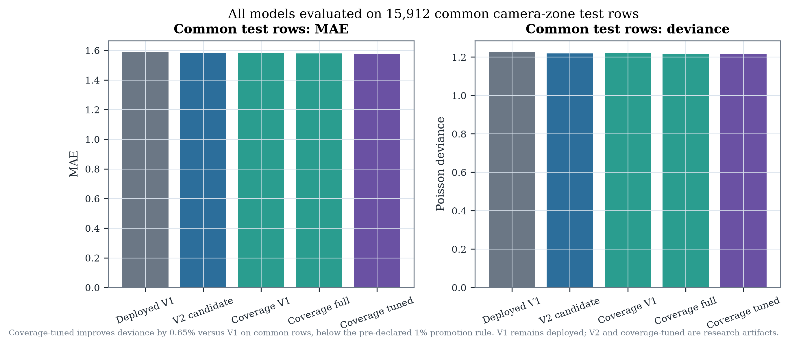

*Figure 10. All models on 15,912 common camera-zone test rows. V1 remains deployed because the pre-declared 1% rule is not met.*

### 10.4 Road-segment experiment

The road model achieves MAE 0.182, Poisson deviance 0.395 and R² 0.351 on 181,512 segment-months. Overall 90% interval coverage is 90.3%, but the highest-risk decile is **60.2%**; hotspot precision is 0.48 and recall 0.46. These figures describe a different unit and population with a 90% zero share and are not comparable to camera-zone MAE.

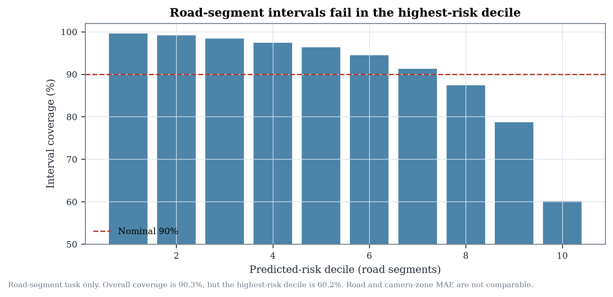

*Figure 11. Road-segment interval coverage by predicted-risk decile. The task is predictive only.*

### 10.5 Recursive deployment scenario

A genuine 12-month deployment cannot observe intervening crashes. Starting in 2025-08 and forecasting 2025-09…2026-08 recursively, feeding predictions into subsequent lags and neighbourhood histories and using climate normals for future weather, V1 achieves MAE 1.645 and deviance 1.286; V2 achieves 1.623 and 1.266. Both over-predict by roughly 10–12%. Recursive and one-step errors are not interchangeable.

---

## 11. Discussion

The most defensible central finding is that the apparent effect of Chicago's speed cameras is highly sensitive to spatial design. The original −7.3% is not fabricated or miscalculated: it reproduces exactly. But it depends on matching each camera to comparison sites anywhere in the city and on retaining cameras whose catchments overlap an already-live camera. With local matching and overlap removal, the estimate is −2.6% with an interval that includes zero.

This does not mean cameras are ineffective. It means the public data, as used here, cannot resolve the effect at the precision needed for a confident policy claim. The result is consistent with the modest effects reported in some evaluations and smaller than the 12% injury reduction reported for Chicago's earlier rollout and the 30% collision reduction reported for New York City over seven months. Differences in program scale, camera density, outcome definition, period and design make direct comparison inappropriate.

The reporting regime is a second design lever. A coverage-consistent 2017-09 design gives −8.6% [−16.9%, +0.4%] on 15 cameras, but it is a different sample, mostly the 2023 cohort, and it sits inside its geographic placebo distribution (p = 0.25). Reporting the original, revised and coverage-consistent estimates together is more honest than selecting the most negative or most significant one.

The forecasting analysis reinforces a broader point: predictive accuracy is not causal identification. V1 predicts monthly crashes reasonably well, but adding 40 features—including real road-network data—improves retrospective deviance by less than half a percent. The coverage-consistent candidate improves deviance by 0.65% on common rows, still below 1%. Camera-status features are nearly unused; crash history dominates. AADT cannot rescue the exposure problem: the public series begins in 2022-07, and the road-segment task changes the unit and population rather than solving identification.

Three policy implications follow. First, do not cite the original −7.3% as a robust causal effect; report the local-design interval and the design sensitivity. Second, invest in measurement—traffic exposure, camera uptime, warning periods, enforcement hours and stable crash reporting—before expanding claims. Third, treat high-risk forecasts cautiously: the model under-predicts the highest-crash months and its intervals under-cover the highest-risk decile.

---

## 12. Limitations

1. **Non-random siting and regression to the mean.** Cameras are placed at high-crash sites; matching on pre-period level and slope reduces but cannot remove mean reversion.
2. **Small treated sample.** Twenty cameras in the primary design; cluster-robust inference is fragile and confidence intervals are wide.
3. **Reporting changes.** 2016 crash volume is roughly one third of 2018; differential reporting changes across neighbourhoods would bias the DiD.
4. **No traffic exposure.** Crashes per catchment-month is not crashes per vehicle-mile.
5. **Spillover and displacement.** The buffer prevents catchment overlap, not behavioural spillover or crash migration.
6. **Treatment timing.** Go-live dates are monthly; warning periods and downtime are unobserved.
7. **Synthetic control.** Moderate pre-fit and opposite sign; it neither confirms nor overturns the DiD.
8. **Test-period reuse.** The 2025-09 … 2026-08 period was inspected in V1; V2 test numbers are retrospective, not a new untouched confirmation.
9. **Forecasting geography.** The location set is crash-dense and non-random; accuracy elsewhere is unknown.
10. **Interval conditional coverage.** The highest-risk decile is covered at 84.8%, below the nominal 90%.
11. **V2 not deployed.** V2 fails the pre-declared 1% validation rule; it is a research candidate.
12. **Road-network vintage.** 2024 TIGER geometry is assumed time-invariant for 2017–2025.
13. **Reporting regime.** The publication causal panel and V1/V2 target include months before citywide reporting; the coverage-consistent estimate is a different, 15-camera sample.
14. **Exposure.** The public AADT extract begins in 2022-07, not 2020-10, and covers only 1,454 distinct 2024 road segments within 50 m.
15. **Road-task ambiguity.** 34.0% of road assignments have a second segment within 5 m; road and camera-zone MAE are not comparable.
16. **Test-period reuse.** All V2 and coverage-consistent test results are retrospective; the period was already inspected in V1.

---

## 13. Conclusion

This paper asked whether Chicago's speed cameras reduce crashes and how sensitive that answer is to research design. The original −7.3% estimate is reproducible but not robust: local matching and overlap removal move it to −2.6% with a 95% interval of −11.5% to +7.2%. A coverage-consistent 2017-09 design gives −8.6% [−16.9%, +0.4%] on 15 cameras, but it is a different sample and does not resolve the uncertainty. The data are consistent with a meaningful reduction, no effect, or a modest increase. A separate LightGBM forecasting system predicts monthly crashes with MAE 1.568 and Poisson deviance 1.223; adding 40 features or rebuilding the coverage regime does not materially improve it, and its high-risk forecasts and intervals remain imperfect. The defensible conclusion is not that cameras fail or succeed, but that credible causal claims require better spatial design and better exposure and operational data than the public record currently provides.

---

## References

Abadie, A., Diamond, A., & Hainmueller, J. (2010). Synthetic control methods for comparative case studies: Estimating the effect of California's tobacco control program. *Journal of the American Statistical Association*, 105(490), 493–505. https://doi.org/10.1198/jasa.2009.ap08746

Barnett, A. G., van der Pols, J. C., & Dobson, A. J. (2005). Regression to the mean: What it is and how to deal with it. *International Journal of Epidemiology*, 34(1), 215–220. https://doi.org/10.1093/ije/dyh299

Bertrand, M., Duflo, E., & Mullainathan, S. (2004). How much should we trust differences-in-differences estimates? *Quarterly Journal of Economics*, 119(1), 249–275. https://doi.org/10.1162/003355304772839588

Callaway, B., & Sant'Anna, P. H. C. (2021). Difference-in-differences with multiple time periods. *Journal of Econometrics*, 225(2), 200–230. https://doi.org/10.1016/j.jeconom.2020.12.001

Cameron, A. C., Gelbach, J. B., & Miller, D. L. (2008). Bootstrap-based improvements for inference with clustered errors. *Review of Economics and Statistics*, 90(3), 414–427. https://doi.org/10.1162/rest.90.3.414

de Chaisemartin, C., & D'Haultfœuille, X. (2020). Two-way fixed effects estimators with heterogeneous treatment effects. *American Economic Review*, 110(9), 2964–2996. https://doi.org/10.1257/aer.20181169

Goodman-Bacon, A. (2021). Difference-in-differences with variation in treatment timing. *Journal of Econometrics*, 225(2), 254–277. https://doi.org/10.1016/j.jeconom.2021.03.014

Graham, D. J., Naik, C., McCoy, E. J., & Li, H. (2019). Do speed cameras reduce road traffic collisions? *PLoS ONE*, 14(9), e0221267. https://doi.org/10.1371/journal.pone.0221267

Hauer, E. (1997). *Observational Before-After Studies in Road Safety*. Pergamon.

Pilkington, P., & Kinra, S. (2005). Effectiveness of speed cameras in preventing road traffic collisions and related casualties: Systematic review. *BMJ*, 330(7487), 331–334. https://doi.org/10.1136/bmj.38324.646574.AE

Stagoff-Belfort, A., Ben-Menachem, J., & Beck, B. (2025). Can speed cameras make streets safer? Quasi-experimental evidence from New York City. *Proceedings of the National Academy of Sciences*, 122(50). https://doi.org/10.1073/pnas.2520328122

Sun, L., & Abraham, S. (2021). Estimating dynamic treatment effects in event studies with heterogeneous treatment effects. *Journal of Econometrics*, 225(2), 175–199. https://doi.org/10.1016/j.jeconom.2020.09.006

Sutton, S., & Tilahun, N. (2022). *Red-Light and Speed Cameras: Analyzing the Equity and Efficacy of Chicago's Automated Camera Enforcement Program*. University of Illinois Chicago. https://indigo.uic.edu/articles/report/Red_Light_and_Speed_Cameras_Analyzing_the_Equity_and_Efficacy_of_Chicago_s_Automated_Camera_Enforcement_Program/22184059

Tilahun, N. (2023). Safety impact of automated speed camera enforcement: Empirical findings based on Chicago's speed cameras. *Transportation Research Record*, 2677(1), 1490–1498. https://doi.org/10.1177/03611981221104808

Wilson, C., Willis, C., Hendrikz, J. K., Le Brocque, R., & Bellamy, N. (2010). Speed cameras for the prevention of road traffic injuries and deaths. *Cochrane Database of Systematic Reviews*, 2010(11), CD004607. https://doi.org/10.1002/14651858.CD004607.pub3

City of Chicago. (2026). *Automated Enforcement*. https://www.chicago.gov/city/en/depts/cdot/provdrs/automated_enforcement.html

Chicago Data Portal. *Traffic Crashes – Crashes* (85ca-t3if); *Speed Camera Locations* (4i42-qv3h); *Speed Camera Violations* (hhkd-xvj4). https://data.cityofchicago.org

Open-Meteo. *Historical Weather API*. https://open-meteo.com/en/docs/historical-weather-api

U.S. Census Bureau. (2017). *TIGER/Line Shapefiles: EDGES* (Cook County 17031; DuPage County 17043). https://www2.census.gov/geo/tiger/TIGER2017/

U.S. Census Bureau. (2024). *TIGER/Line Shapefiles: ROADS/EDGES* (Cook County 17031; DuPage County 17043). https://www2.census.gov/geo/tiger/TIGER2024/

Chicago Data Portal. *Average Daily Traffic Counts* (gc7y-n4xa). https://data.cityofchicago.org/d/gc7y-n4xa

City of Chicago. *Boundaries – Community Areas* (igwz-8jzy). https://data.cityofchicago.org/resource/igwz-8jzy.geojson

---

## Appendix A — Reproducibility

The complete analysis is reproducible from the public portal snapshot and the repository:

```bash
python scripts/download_data.py
python -m chicago_cameras.pipeline --config config/analysis.yaml
python scripts/verify_replication.py
python scripts/train_lightgbm.py --trials 40 --timeout 900
python scripts/train_lightgbm_v2.py --trials 40 --timeout 900
python scripts/evaluate_recursive_v2.py
python -m chicago_cameras.coverage
python -m chicago_cameras.exposure
python -m chicago_cameras.road_network
python -m chicago_cameras.ml.coverage_dataset
python -m chicago_cameras.ml.reconstruction
python -m chicago_cameras.ml.tune_coverage
python -m chicago_cameras.ml.road_model
python -m pytest -q
streamlit run dashboard/app.py
```

- **Causal artifacts:** `results/estimates.json`, `results/tables/`, `results/figures/`, `results/analysis_panel.parquet`.
- **Forecasting artifacts:** `models/v1/`, `models/v2_*`, `results/ml/v1/`, `results/ml_v2/`.
- **Data provenance:** `data/raw/provenance.json`, `data/raw/tiger/provenance.json`.
- **Seeds:** 20261024 for all stochastic procedures; deterministic LightGBM settings.
- **Bottom-up artifacts:** `results/bottom_up/`, `docs/BOTTOM_UP_AUDIT.md`, `paper/bottom_up_reconstruction.md`.
- **Tests:** 63 pass; CI runs the suite without downloading the crash data.
- **Original notebook:** preserved unchanged at the repository root.
- **Model decision:** V1 deployed; V2 candidate retained under the pre-declared rule.

All figures in this paper are generated by `scripts/make_publication_figures.py` from saved results and cleaned data. No values are hand-entered except the published original estimate, which is read from `results/estimates.json`, and the coverage-consistent estimates, which are read from `results/bottom_up/coverage_causal/estimates.json`.
